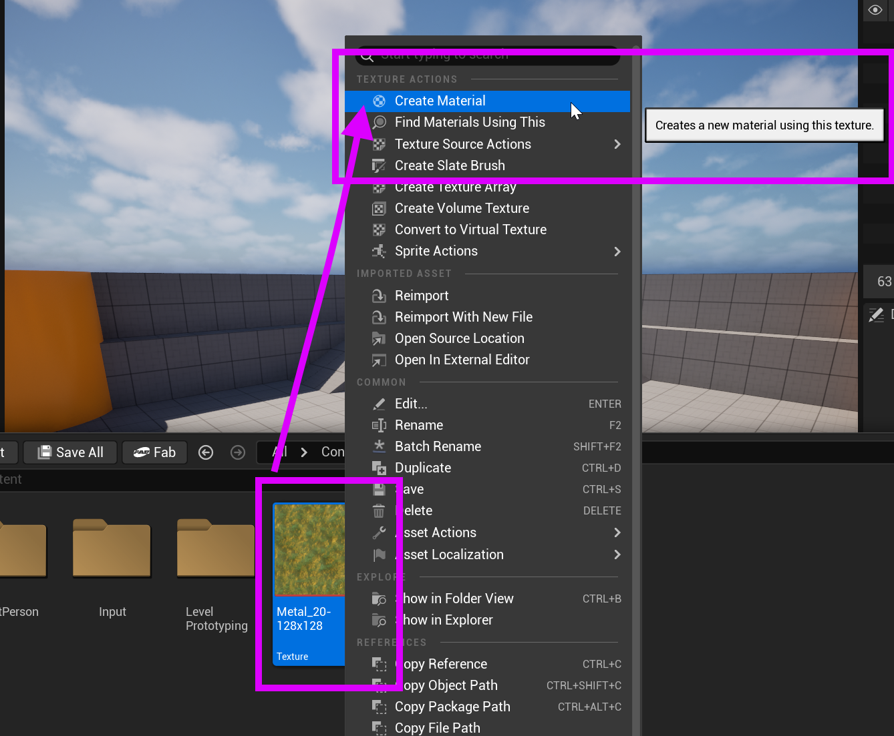
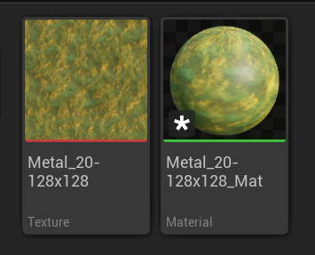

# Unreal: Materials: Converting Textures to Materials

> Legacy lesson, organized for self-study. Screenshots may show an older editor. See the Unreal 5.8 verification scope (legacy attachment omitted) before relying on version-specific steps.

Images are textures in Unreal. However, we want to work with **materials**, which are assets we can use to "paint" a mesh.

In Unreal, we can right-click on an image (texture) we have previously imported into Unreal and ask it to convert the asset into a material.

*Figure: Screenshot showing the process of right-clicking to create a material from a texture.*

When the material is created, it will be placed alongside the previous texture as a new asset.

*Figure: Screenshot showing the created material based on the texture of the same name.*
