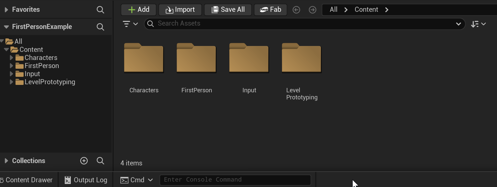
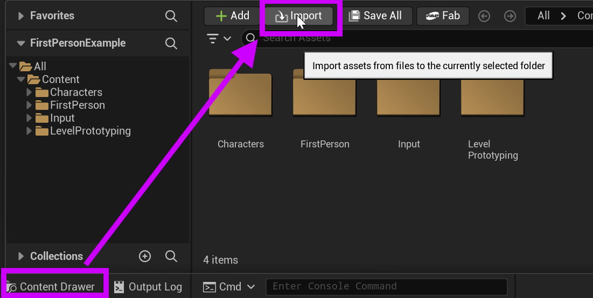
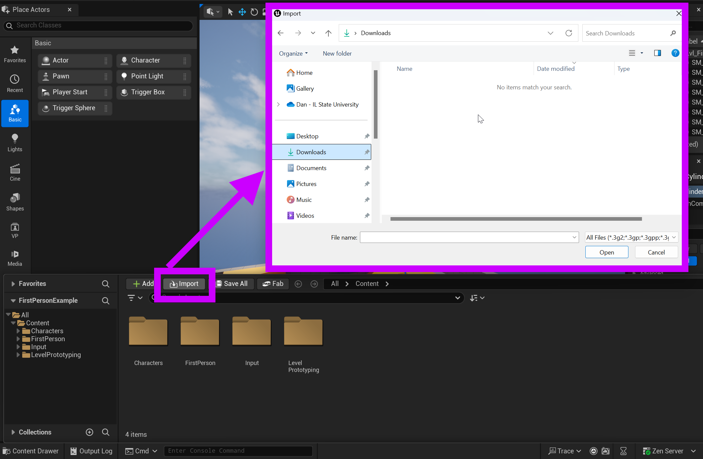

# Unreal: Materials: How do we import assets into Unreal?

> Legacy lesson, organized for self-study. Screenshots may show an older editor. See the Unreal 5.8 verification scope (legacy attachment omitted) before relying on version-specific steps.

## What is the Content Drawer?

Materials are among a number of assets we may want to import into Unreal. To do this, we use the Content Drawer, the bottom, left-most option in Unreal.

*Figure: Screenshot highlighting the position of the Content Drawer in Unreal.*

The **Content Drawer** acts as a "drawer," it opens when we click on the button and then closes when we click away. This is important to remember, as we sometimes want to work on assets and then something else.

*Figure: Screenshot of the Content Drawer opened in Unreal.*

## How do we import?

The Import button in the Content Drawer allows us to import other files into a project in Unreal.

*Figure: Screenshot highlighting the Content Drawer and Import option in Unreal.*

When we click on "Import", we get a window prompt to select one or more files to then import into a project in Unreal.

*Figure: Screenshot highlighting the open window using the "Import" option.*
