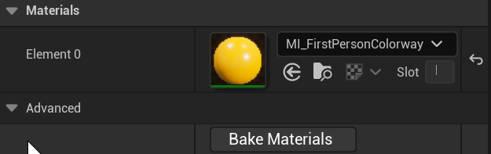
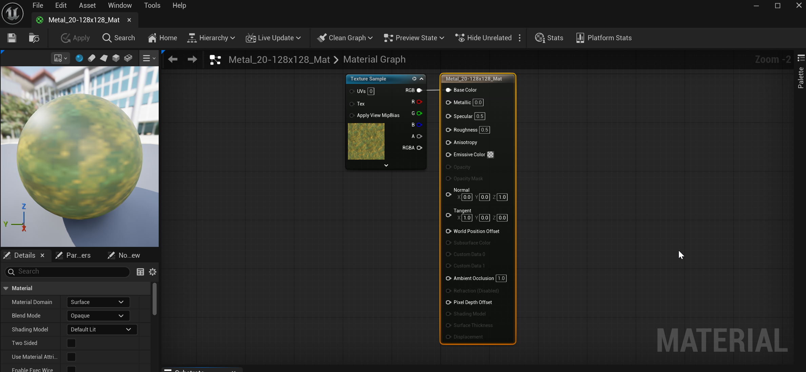

# Unreal: Materials: What is a material?

> Legacy lesson, organized for self-study. Screenshots may show an older editor. See the Unreal 5.8 verification scope (legacy attachment omitted) before relying on version-specific steps.

We have already seen a **volume**, some defined space in a level in Unreal.

We have also now seen a **mesh**, some shape in a three-dimensional space.

## *What is a material?*

A **material** [is a way to "paint" over some mesh](https://dev.epicgames.com/documentation/en-us/unreal-engine/unreal-engine-materials).

We use materials to "cover" a mesh and to define four important visual aspects:

- **Color**: Combinations of red, green, and blue.
- **Texture**: Use of an image to "paint" one or more sides of a volume.
- **Shininess**: To what degree light is reflected from it. For example, if something is mirror-like, it would reflect most if not all light directed toward it.
- **Light**: To what degree light is generated from the volume.

*Figure: Screenshot showing the Materials of an example volume in Unreal.*

## *How do we edit materials?*

Double-clicking on an assigned material will open its own Blueprints screen for editing aspects about it. This is important, as we can also program aspects of a material in the same way we have been working with other components in the Blueprints Editor within Unreal.

When editing a material, Unreal will hopefully add the word "MATERIAL" in the lower, right-hand corner of the Blueprints Editor to help developers know what they are editing.

*Figure:Screenshot showing a blueprint for a material.*
