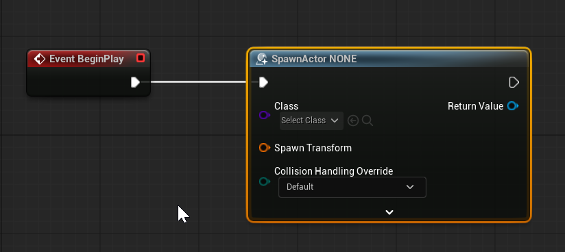
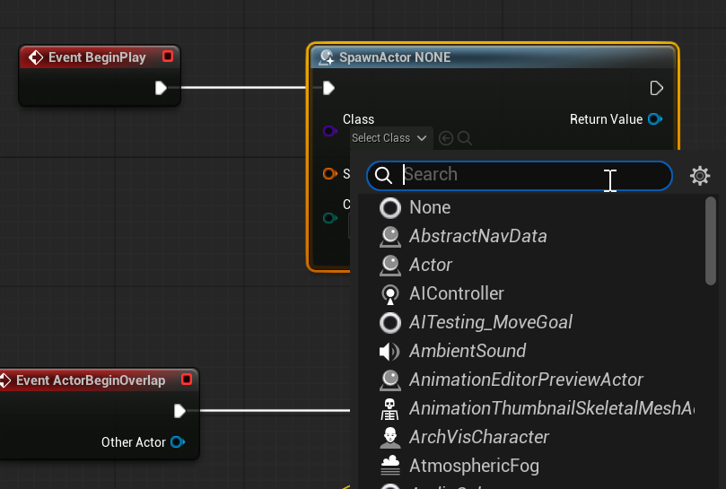

# Unreal: Spawning: What is spawning?

> Legacy lesson, organized for self-study. Screenshots may show an older editor. See the Unreal 5.8 verification scope (legacy attachment omitted) before relying on version-specific steps.

In Unreal, the act of **spawning** is the creation of something within a level.

We often need to create something dynamically. This might be a projectile. It might be the playing of a sound. It could be many things.

In Blueprints, we use the [Spawn Actor From Class](https://dev.epicgames.com/documentation/en-us/unreal-engine/BlueprintAPI/Game/SpawnActorfromClass "Link") node to create something in a generic way. This will allow us to create (spawn) something in a level, assuming we have a Blueprint from it. (Depending on the type, we can also use special functionality for this action, too!)

*Figure: Screenshot of the SpawnActorFromClass node with NONE selected as the class to spawn.*

(The use of the word *class* is borrowed from object-oriented programming. When we create a Blueprint, we are also creating a class as well, internally. For Unreal, Blueprint can be converted into a C++ class, and special types of C++ classes can be translated into a Blueprint.)

If we have created a Blueprint, we can *spawn* it at a later location.

In the SpawnActorFromClass node, select the class from the drop-down menu.

*Figure: Screenshot showing the drop-down listing of all possible blueprints to spawn.*
