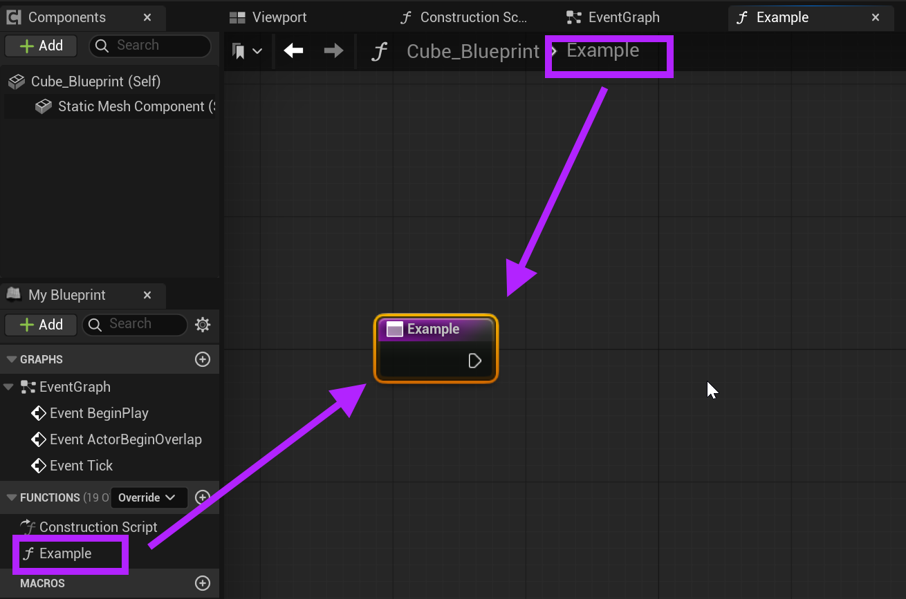
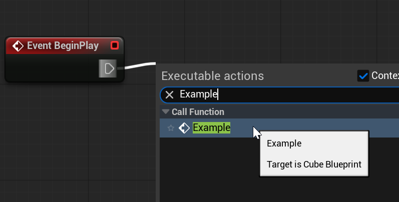

# Unreal: Blueprints: Functions: What is a function?

> Legacy lesson, organized for self-study. Screenshots may show an older editor. See the Unreal 5.8 verification scope (legacy attachment omitted) before relying on version-specific steps.

In Blueprints, a **function** is a sub-graph. Functions allow developers to define sequences of nodes capable of accepting input and producing output. These sequences can then be represented as a single *function* node in another graph.

Like variables, new functions can be added using the left-hand sidebar of the My Blueprint panel under Functions in the Blueprint Editor.

Creating a function named **Example** would create a graph with a node named *Example.* This node would represent the start of some sequence of nodes where, when the function is used, the entire sequence would be run from left to right:

*Figure: Screenshot showing the connection between Function and their status as a sub-graph.*

Once defined (and compiled!), functions can be referenced in any other graph within the same Blueprint using its name. Because functions are sub-graphs, it is often useful to define a sequence and then use an event node in the Event Graph to activate the function somehow:

*Figure: Screenshot showing the "Example" function as a node in the current Blueprint.*

## *Why use functions?*

In many cases, adjusting the values of variables is enough. However, consider the example of a variable named *health* whose value has a maximum of 100 and minimum of 0. As a character gets hurt, this value would be decreased. As they encounter health pick-ups, this value increases.

Accessing the variable *health* directly would allow changing its value. However, what about the situation where *health* decreases to 0 and the session would end? There would need to be some code to detect if this has happened and react in some way. By creating functions to affect variables like *health*, the function could be used to adjust the value and end the session or show a menu.
