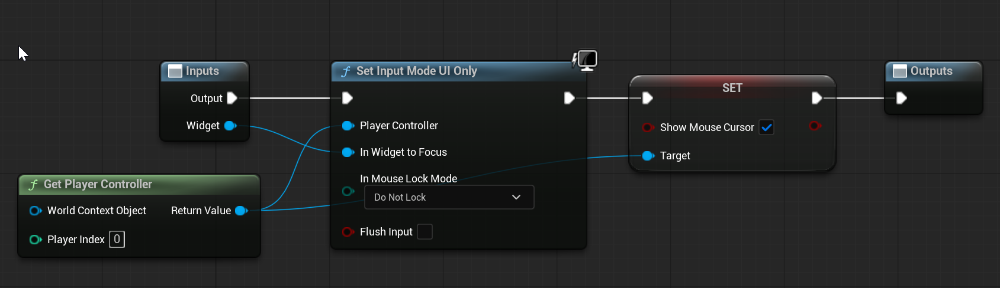
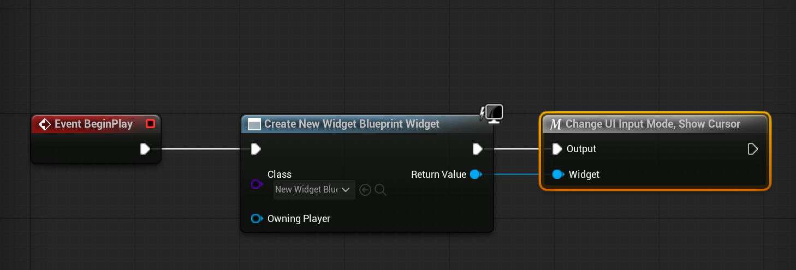

# Unreal: Blueprints: Macros: Example: Switch Input Mode, Show or Hide Cursor

> Legacy lesson, organized for self-study. Screenshots may show an older editor. See the Unreal 5.8 verification scope (legacy attachment omitted) before relying on version-specific steps.

Writing our the sequence to adjust the input mode and show and hide the cursor can take time. It is often easier to create useful macros for these operations.

Let's look at an example named "Change UI Input Mode, Show Cursor" in a macro library.

*Figure: Screenshot of Set Input Mode UI and Show Cursor.*

Once defined in the library, it is available everywhere in the game.

*Figure: Screenshot of named macro "Change UI Input Mode, Show Cursor" use in a Level Blueprint.*
