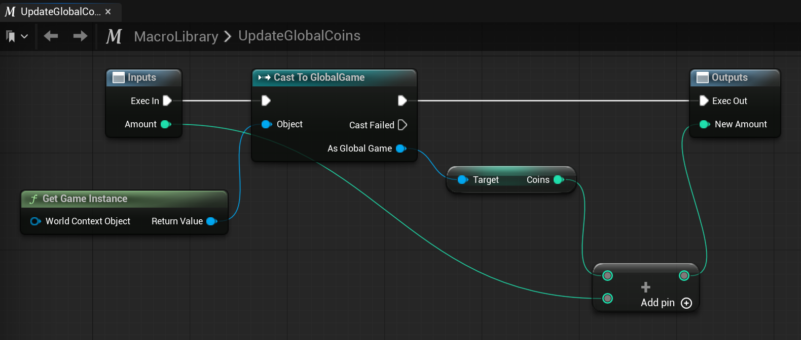

# Unreal: Blueprints: Macros: Examples: Update Global (Game Instance) Coins

> Legacy lesson, organized for self-study. Screenshots may show an older editor. See the Unreal 5.8 verification scope (legacy attachment omitted) before relying on version-specific steps.

As we use the Game Instance to store game-wide data, it is often useful to define a project-wide macro for changing a single variable like *coins* that may be used in multiple places and across levels.

## Example

*Figure: Example macro for updating "Coins" using a Game Instance.*
