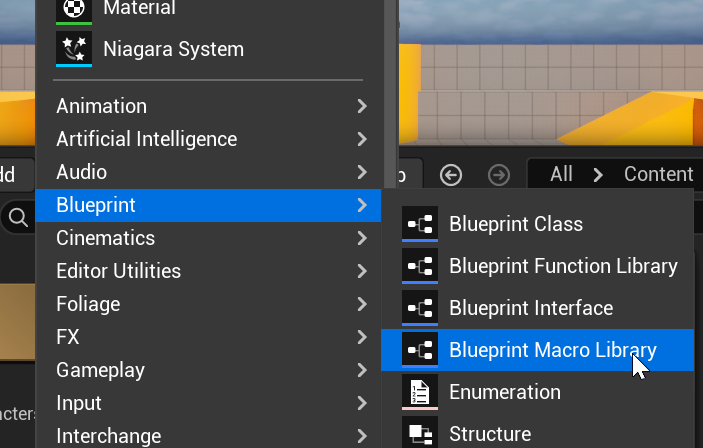
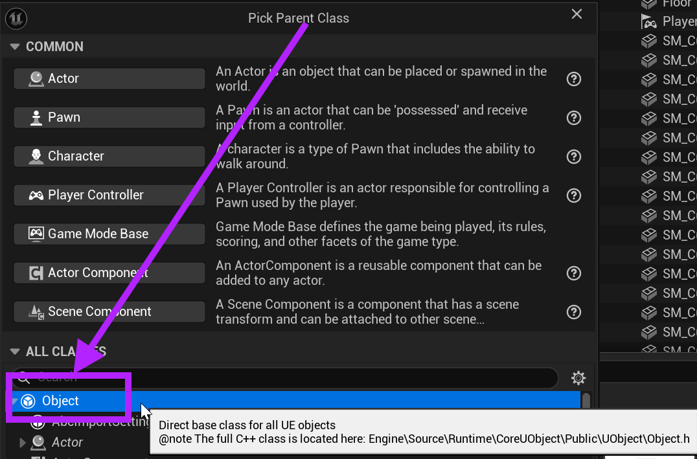

# Unreal: Blueprints: Macros: What is a macro library?

> Legacy lesson, organized for self-study. Screenshots may show an older editor. See the Unreal 5.8 verification scope (legacy attachment omitted) before relying on version-specific steps.

We can use macros in individual blueprints, but they also support an extremely use concept name **macro lib**r**aries**.

We can write code in one place for a whole project and use it anywhere else we might need it.

**As long as it is in the ‘library’, we can ‘borrow’ it whenever we need it.**

After opening the Content Drawer, click on "+Add" or right-click.

Go to Blueprints —\> Blueprint Macro Library.

*Figure: Screenshot of Blueprint -\> Blueprint Macro Library.*

Choose "Object" as the parent class:

*Figure: Screenshot highlighting the selection of "Object" as the type.*

Name the resulting file something like “Macro_Library” or whatever is most useful.

Double-click to open the file.

The rules of using macros are the following:

- Cannot contain variables.
- Cannot be placed in levels.

Each macro library, assuming there might be more than one, is simply a listing of macros (inputs, sequences, and outputs).
