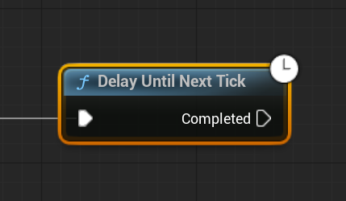

# Unreal: Flow Control: Delay Until Next Tick

> Legacy lesson, organized for self-study. Screenshots may show an older editor. See the Unreal 5.8 verification scope (legacy attachment omitted) before relying on version-specific steps.

As we program sequences of nodes in Blueprints, we often want to delay an action based on some amount of fixed time. For that, there is the Delay node. For other uses, we may want to wait until the next frame.

In Unreal, there is a node named Delay Until Next Tick.

*Figure: Screenshot of Delay Until Next Tick node in Blueprints.*

## *Why would we want to delay until the next tick?*

It may seem strange. Why would we want to wait until the next tick? Why not wait a specific amount of time? For many cases, waiting until the next frame is a better approach than trying to handle specific timing across multiple nodes.

For many cases specifically related to user interface elements, it is easier to simply wait until the next screen refresh, what we think of as a frame, to make sure everything is a smoother experience.
