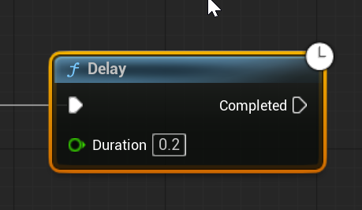

# Unreal: Flow Control: Delay

> Legacy lesson, organized for self-study. Screenshots may show an older editor. See the Unreal 5.8 verification scope (legacy attachment omitted) before relying on version-specific steps.

As we program sequences of nodes in Blueprints, we often want something to happen after an amount of time.

In Unreal, there is a node to help us with us named Delay.

*Figure: Screenshot of the Delay node.*

## Wait... And then act!

The Delay node will *delay* the next execution after some amount of time. This can be very useful for situations like, for example, trying to define invincible frames between successful attacks in a game experience.
