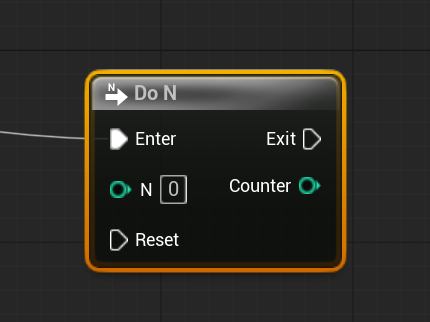

# Unreal: Flow Control: Do N

> Legacy lesson, organized for self-study. Screenshots may show an older editor. See the Unreal 5.8 verification scope (legacy attachment omitted) before relying on version-specific steps.

As we program sequences of nodes in Blueprints, we often want something to happen a multiple number of times and then not again. For example, we might want something to move a certain number of steps and then stop until started again.

In Unreal, this is known as the Do N node.

*Figure: Screenshot of Do N node.*

## A Do N Will Loop

Rather than using a more traditional loop structure, as might be found in other programming languages, a Do N node is a very useful tool to perform actions a set number of loops before stopping.

Like its sister, Do Once, the Do N node can also be reset based on connecting back its input execution pin.
