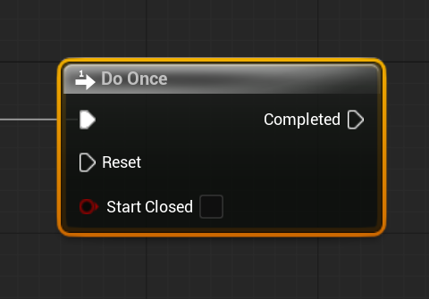

# Unreal: Flow Control: Do Once

> Legacy lesson, organized for self-study. Screenshots may show an older editor. See the Unreal 5.8 verification scope (legacy attachment omitted) before relying on version-specific steps.

As we program sequences of nodes in Blueprints, we often want something to happen once and only once. For example, we might write code to run as part of the first tick and then never again.

In Unreal, this is known as the Do Once node.

*Figure: Screenshot of Do Once node.*

## A Do Once Runs Once, Unless Reset

By default, the input pin of "Start Closed" will be disabled (meaning it is "open"). Anything that is run after the Do Once will be run *once* unless the pin is reset and the execution path returns to the node in the future and the input pin of "Reset" is used.
