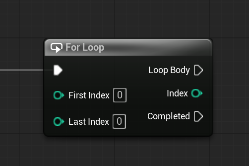

# Unreal: Flow Control: For Loop

> Legacy lesson, organized for self-study. Screenshots may show an older editor. See the Unreal 5.8 verification scope (legacy attachment omitted) before relying on version-specific steps.

As we program sequences of nodes in Blueprints, we often want to loop through a series of steps or act on complex data. Once of the ways we can loop is using a "for" structure.

In Unreal, we have access to a For Loop node.

*Figure: Screenshot of the For Loop node in Blueprints.*

## Why not use a Do N node?

A For Loop node has an input pin for where to start and where to end. A Do N node only has a counter.

In many cases, we want to be specific about where we are starting and ending. The For Loop node allows us to do that.
