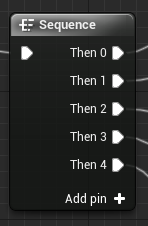

# Unreal: Flow Control: Sequence

> Legacy lesson, organized for self-study. Screenshots may show an older editor. See the Unreal 5.8 verification scope (legacy attachment omitted) before relying on version-specific steps.

The **Sequence** node allows us to define *sequences* of actions to take place one after another. For example, we may want an Actor to play a sound and then move. Each of these would be an action *sequence* and we could define them as such.

*Figure: Screenshot of Sequence Node*

The **Sequence** node allows us to define collections of things to happen one after another.
