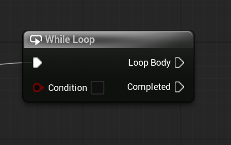

# Unreal: Flow Control: While Loop

> Legacy lesson, organized for self-study. Screenshots may show an older editor. See the Unreal 5.8 verification scope (legacy attachment omitted) before relying on version-specific steps.

As we program sequences of nodes in Blueprints, we often want to loop through a series of steps until something happens. In other programming environments, we often calls this a "while" structure. Based on some condition, a loop will continue.

In Unreal, this functionality is known as the While Loop node.

## Loop Until Condition Changes

The While Loop node can be very powerful in Blueprints. In cases where we want to carry out actions, we can continue until they are done or something else happens first.
