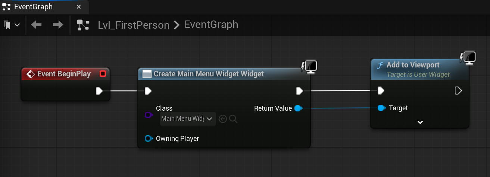

# Unreal: Blueprints: Levels: For Main Menus and Heads-Up Display, use Level

> Legacy lesson, organized for self-study. Screenshots may show an older editor. See the Unreal 5.8 verification scope (legacy attachment omitted) before relying on version-specific steps.

For common usage patterns like Main Menus and Heads-up Display (HUD) usages, we will use the Level Blueprint and its BeginPlay event to create the widget for us with bound data from other Blueprints.

*Figure: Screenshot of using Level Blueprint to spawn widget.*
