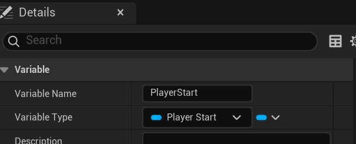
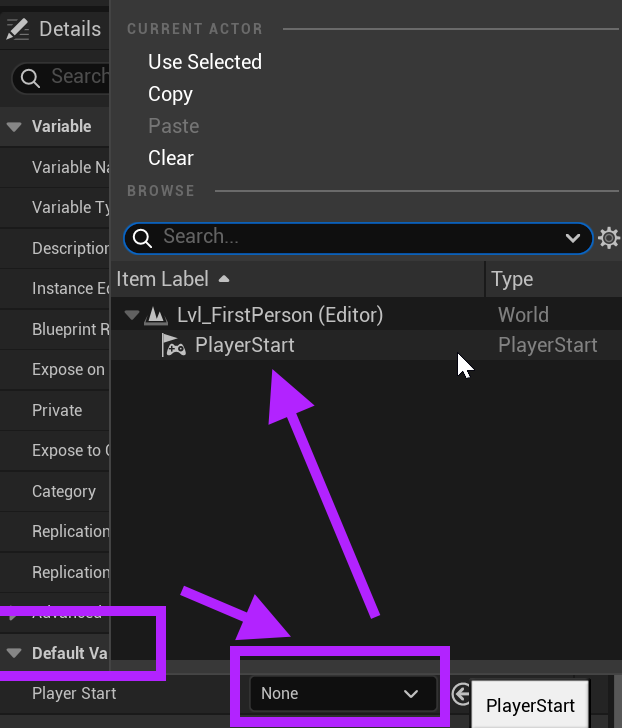
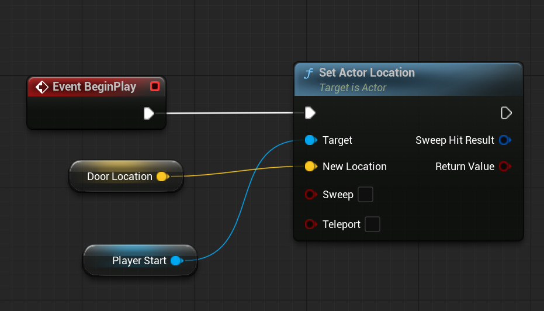

# Unreal: Blueprints: Levels: Levels "reaching down" to actors

> Legacy lesson, organized for self-study. Screenshots may show an older editor. See the Unreal 5.8 verification scope (legacy attachment omitted) before relying on version-specific steps.

A level is a collection of actors. However, it does have a Blueprint. This means events we have already seen, like BeginPlay, can be used to perform some actors. This is important, as the BeginPlay event happens first at a level and *then* to the actors inside of it.

There are some common patterns for how the Level Blueprint can interact with Actor Blueprint.

## Binding to and Preparing Actors with Values

We have already seen the term *binding* as it applies to Widgets. We can bind to value and have it use other code to pull data from another source. Commonly we may want, for example, a heads-up display to show data stored in the PlayerCharacter or a Game Manager Blueprint.

Let's look at an example.

*Let's assume that the player-character has returned from moving to another level. Normally, they would spawn at the PlayerStart location, which might be in the middle of the level. However, we don't want that to happen. We want the player-character to "return" to right outside the door they entered. We could wait for the spawn to happen and then move the actor, but we can also bind to the PlayerStart actor and change its location before the spawn happens.*

I have created a variable on the Level Blueprint named *PlayerStart* of the type Player Start as an object reference.

*Figure: An example variable named "PlayerStart" as an object reference to the PlayerStart actor in a level.*

A level "knows" about the actors it contains. This means we can set the default value of the variable in the Details tab to the existing PlayerStart actor in the level.

*Figure: Selecting the PlayerStart actor from the current actors in the level.*

Assuming a DoorLocation value was set before entering the door, we can return the actor to the location in code something like the following:

*Figure: Example code in the Level Blueprint to access the Door Location (Vector) and Player Start.*
