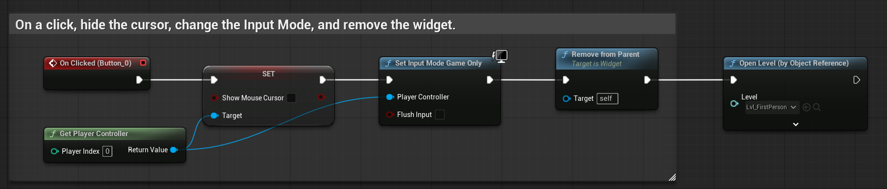

# Unreal: Blueprints: Levels: Open Level (Load a level, replacing current one)

> Legacy lesson, organized for self-study. Screenshots may show an older editor. See the Unreal 5.8 verification scope (legacy attachment omitted) before relying on version-specific steps.

We often want to treat a level as a "section of the game." In Unreal, the node **Open Level** allows us to "move" to another level, replacing the current one. This is very useful to help us think about a game as a series of different content areas.

(Frequently, we use the **Open Level (By Object Reference)** to allow us to select the level we want rather than supplying a name by typing it.)

A very common example is combining the existing "hide cursor, switch input mode, remove widget" with **Open Level** at the end of the sequence.

*Figure: Screenshot of sequence ending with Open Level (by Object Reference).*
