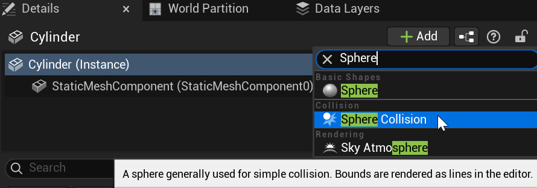
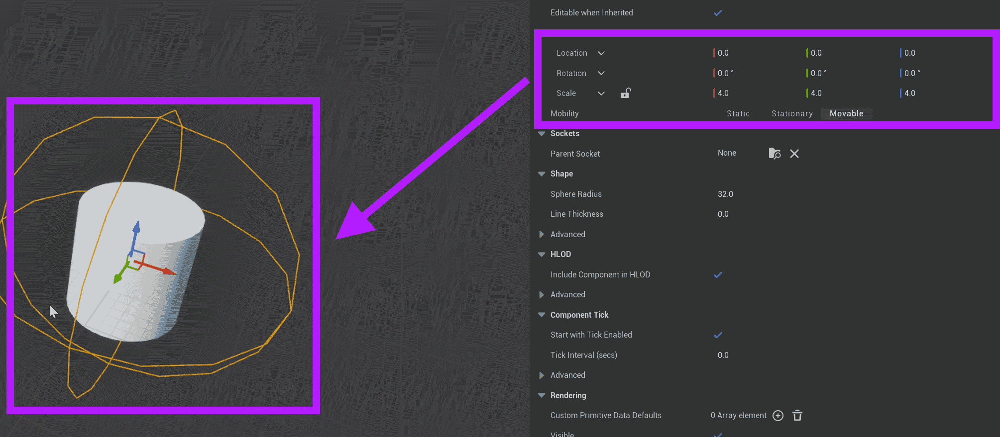
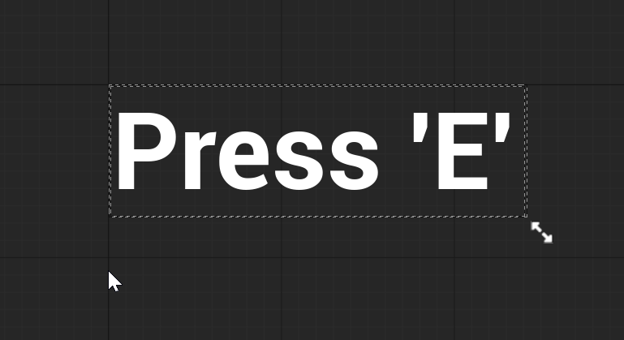
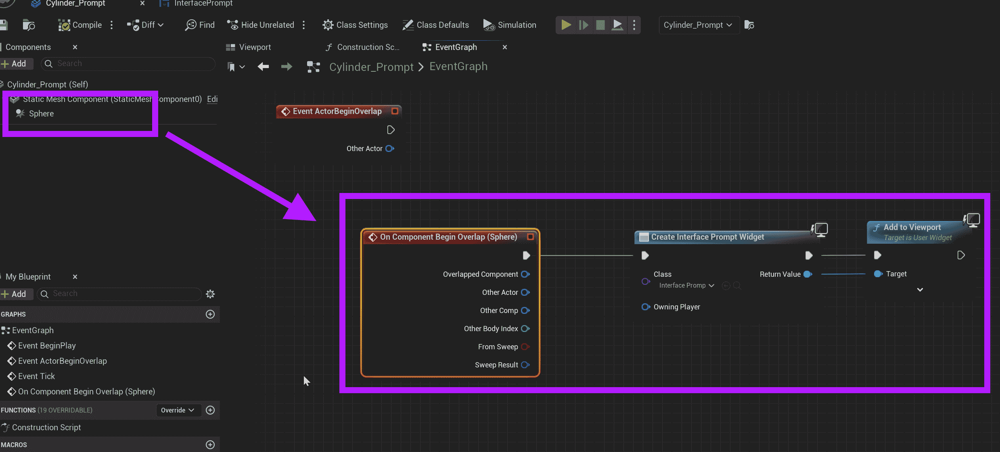
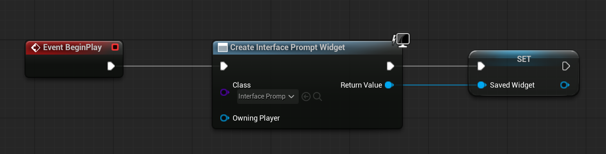
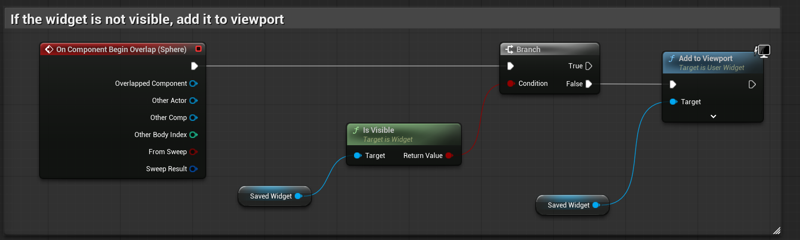
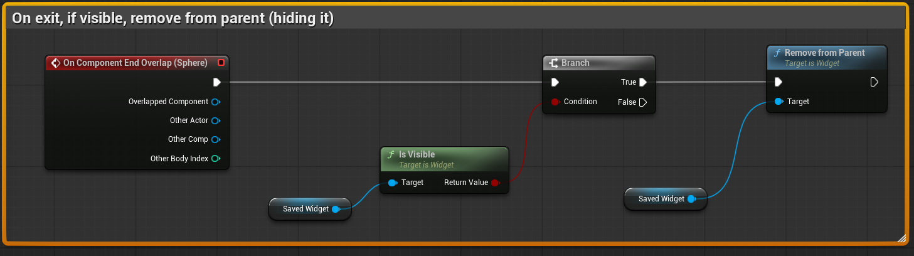
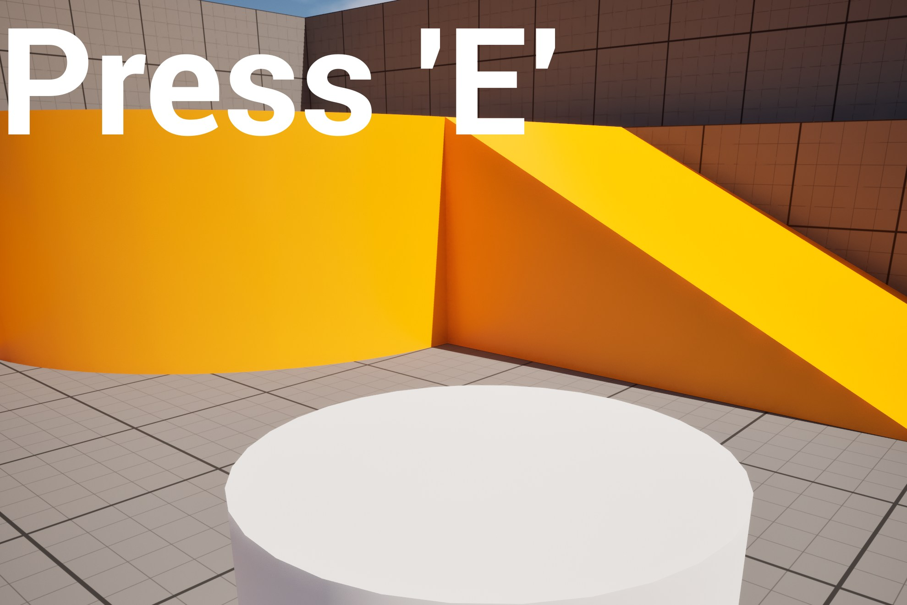

# Unreal: Interaction Prompt: Show Widget Fullscreen

> Legacy lesson, organized for self-study. Screenshots may show an older editor. See the Unreal 5.8 verification scope (legacy attachment omitted) before relying on version-specific steps.

There are many games where a player-character approaches some character or object sees an interaction prompt.

Let's think through this.

- An actor can contain multiple components.
- We can add one component to detect if a player-character enters the area.
- Let's then show the player a message (Widget).

## Understanding Begin and End Overlap

We have looked at the event Overlap. Specifically, we have looked at the event *Begin* Overlap. This naming is very important. We have been using the event that happens as a result of the start of an overlap event. There is also another event: *End* Overlap. If we want to detect when another object leaves an overlap, we can also detect this as well.

Here are rules we want to implement with the sphere collision:

- When the player-character enters (begin overlap) the sphere overlap area, a prompt will be added to the screen.
- When the player-character leaves (end overlap), the prompt will be removed.

## Adding an Actor

First, let's add an actor. (In this example, a cylinder was used.)

Next, let's add a sphere collision.

*Figure: Screenshot of adding Sphere Collision component.*

Convert the cylinder into a blueprint.

Open the blueprint.

Select the Sphere Collision.

Expand the scale of the component, making sure it expands beyond the actor itself.

*Figure: Screenshot showing the scaled collision component.*

## Preparing a Simple Widget

Save the current changes.

In the Content Drawer, create a Widget Blueprint.

Add a border, canvas, and then text.

Adjust the brush color of the border to have a low alpha.

Adjust the font size to a larger size.

Decrease the overall size of the widget.

In this example, I used the phrase "Press 'E'"

*Figure: Screenshot of a prompt example.*

Save the widget.

## Preparing the Prompt Code

Return to the cylinder and its collision code.

Use a pattern we have used before.

Select the Sphere Collision component. Use its overlap event.

*Figure: Screenshot showing the node sequence.*

Finally, we need to consider a new problem. There might be situations where the player-character approaches the new object and we show the widget. There might also be situations where the widget is showing and the player-character moves outside the detection range.

Based on the different contexts, we need two things:

- Somehow detect if the widget is being shown.
- Branch based on this information.

In Unreal, the [Is Widget Visible](https://docs.unrealengine.com/5.1/en-US/BlueprintAPI/UserInterface/IsWidgetVisible/) node solves the first problem. If the widget has been added to the Viewport, it is visible. If it has not, it is not visible.

Our programming needs to work like the following:

- When play begins, make the widget and save it to a variable.
- If a begin overlap happens, and the widget is not already visible, show the widget.
- If an end overlap happens, and the widget is visible, remove the widget from its parent (which makes it not visible).

For the first, the code would be the following:

*Legacy remote illustration omitted.**Figure: Screenshot of saving the created widget to a local variable.*

For the second:

*Figure: Screenshot of adding widget to Viewport.*

And for the third:

*Figure: Screenshot of final sequence.*

Put all together, the widget will be shown to the player when the player-character enters the sphere collision space on the beginning of overlap. As long as they are close to the actor, it will show the prompt. Once they leave the range (end overlap), the widget is hidden.

*Figure: Screenshot of "Press 'E'" when player-character enters the range of the cylinder as defined by the sphere collision.*
