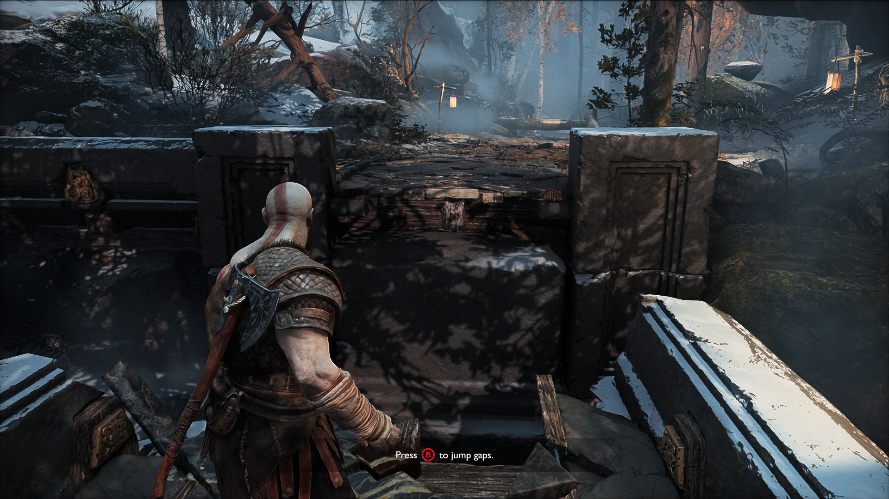
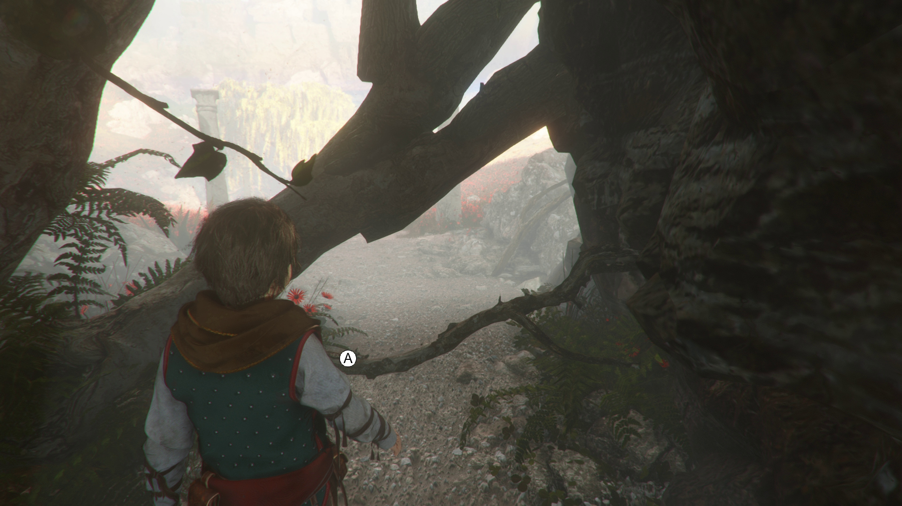

# Unreal: Interaction Prompt: What is an interaction prompt?

> Legacy lesson, organized for self-study. Screenshots may show an older editor. See the Unreal 5.8 verification scope (legacy attachment omitted) before relying on version-specific steps.

At a broad level, an *interaction* is anything done between one system and another. We can think about interactions as game mechanics between *characters* in a level. We can, for example, interact with an object through pushing it. We can also provide guidance to a player about what things have interactions and which things do not.

When we provide guidance, we are giving them a **prompt**. We are letting the player know what action to perform (generally pressing a button) to we can help guide them in the interaction they need to perform.

## Example Prompts

We often want to show the player information in a menu-like interface. (In Unreal, of course, we call these *widgets*.)

*Figure: Screenshot from God of War (2018) showing message to player.*

*Figure: Screenshot from A Plague Tale: Innocence (2019).*
