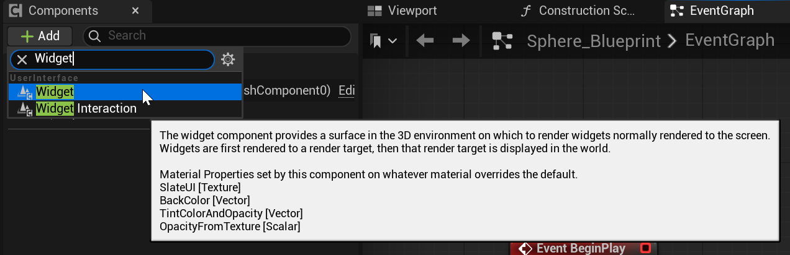
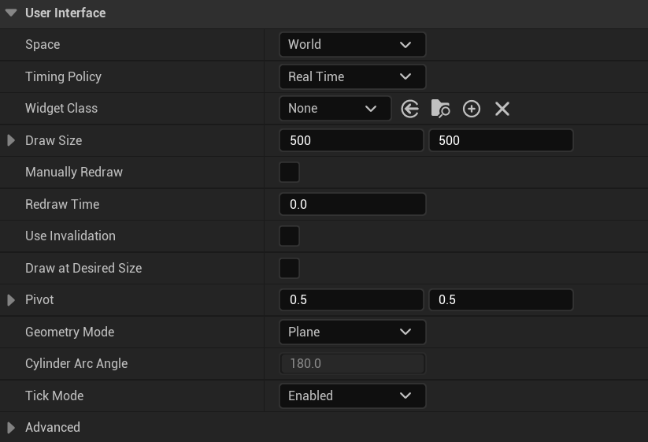
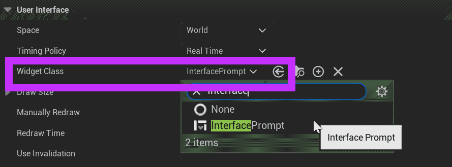
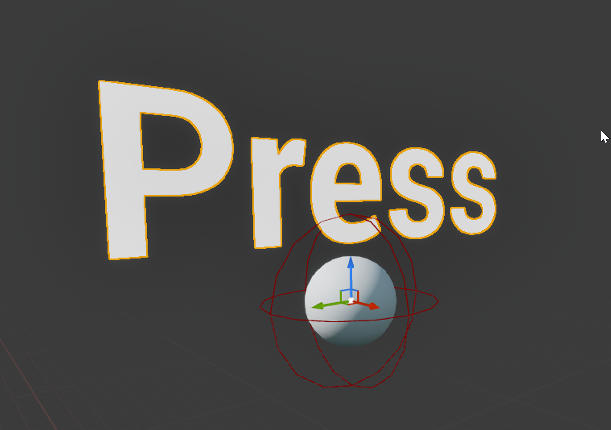
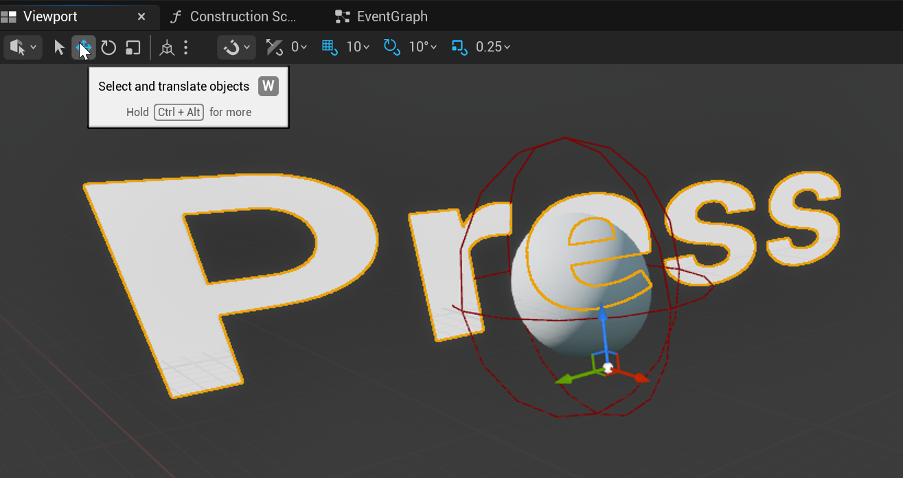
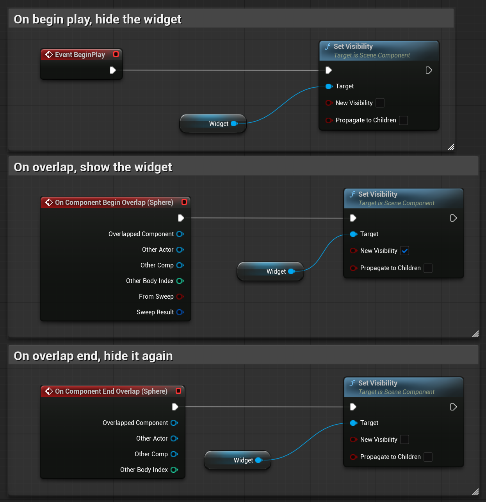
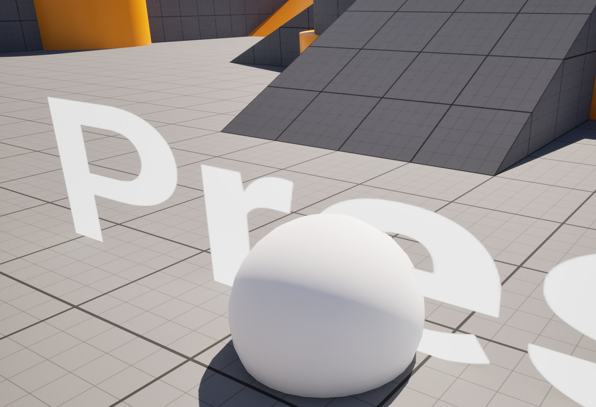
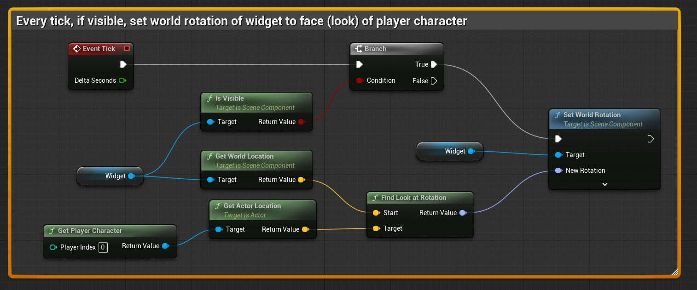

# Unreal: Interactions Prompt: Widget Component + Find Look Rotation

> Legacy lesson, organized for self-study. Screenshots may show an older editor. See the Unreal 5.8 verification scope (legacy attachment omitted) before relying on version-specific steps.

While there are some contexts when we want to show a widget in the full-screen mode, we often want the widget in front of the object or as information for an action. For this, we need to change our approach. Rather than create and then remove, we can use something different.

An actor can add a **Widget Component**.

*Figure: Screenshot of adding Widget component to an actor.*

When we add a Widget Component, it switches from the normal "screen" to a different space usage, "World." When a widget is positioned in the world, it appears as a 3D mesh within the world.

This option appears as a section within the Details window with the component selected.

*Figure: Screenshot showing the User Interface section of Widget Component.*

We also need to set the Widget Class to the created widget.

*Figure: Screenshot highlighting the Widget Class option.*

Once the widget is added, it will appear in the Viewport tab.

*Figure: Screenshot showing the widget in the Widget Component.*

As a component, we can adjust its Transform.

*Figure: Screenshot showing adjustment of widget as sizable component.*

## Updating Code

Every widget has access to the node **Set Visibility**. We can use this to "hide" and "show" the widget based on its initial visibility, which is *true*.

*Figure: Screenshot of core events.*

## Turn to Player Character

If you use the new code, you will notice an issue.

*Figure: Screenshot of prompt facing slightly away from player character.*

The widget will always appear where it was set to. To have it "turn" to the player, we need to know three things:

- The player's character's current location.
- The widget component's current world location.
- The angle between them.

In Unreal, there is a very helpful node for the last item: **Find Look at Rotation**.

*Figure: Screenshot of completed code to turn widget component to face the player character.*
