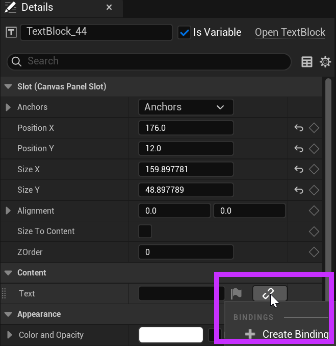
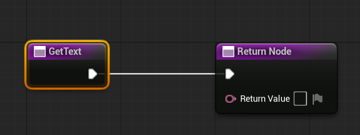
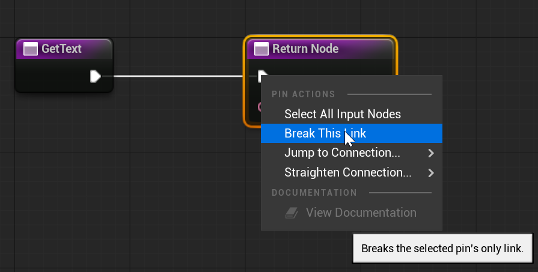
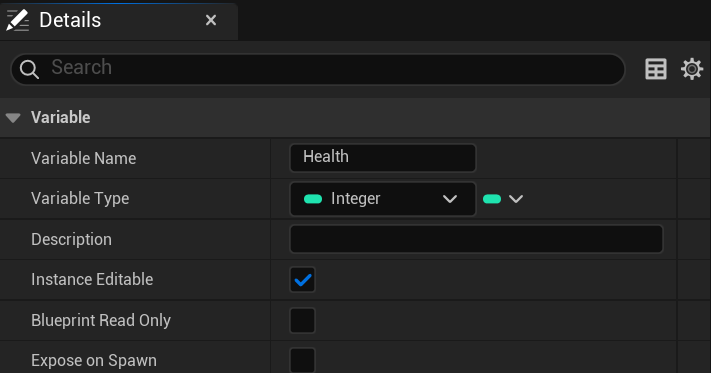
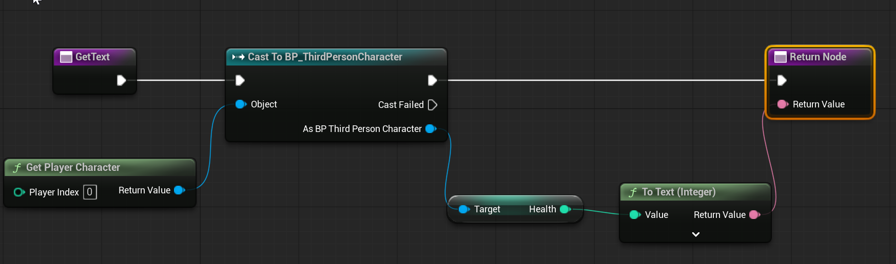
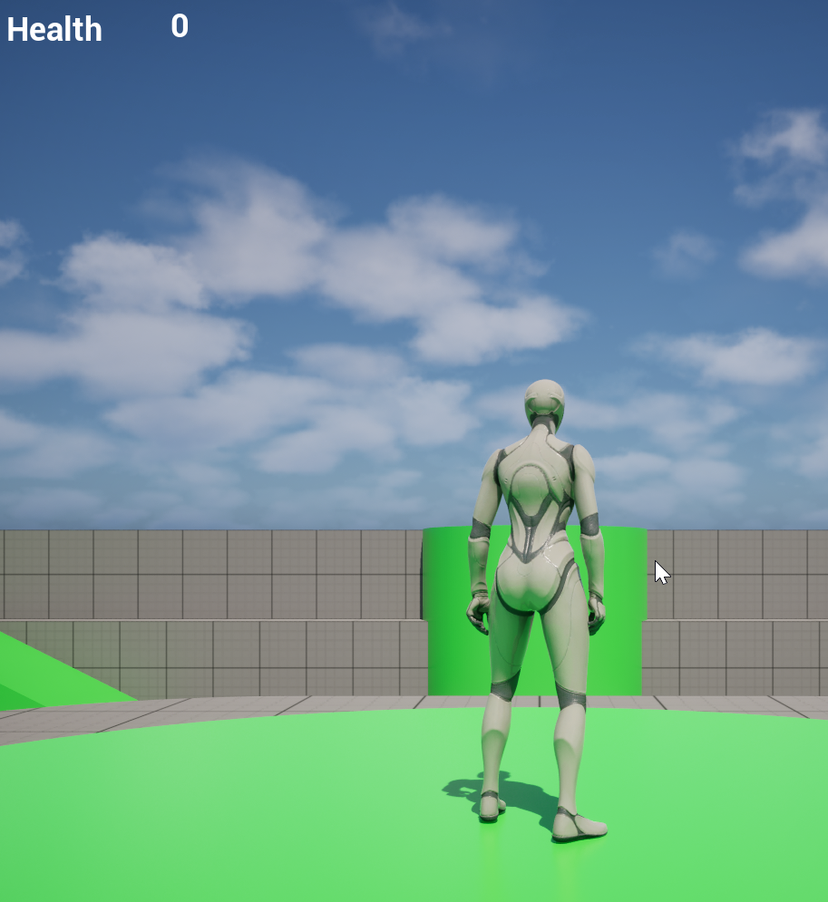

# Unreal: Widgets: Binding Variables

> Legacy lesson, organized for self-study. Screenshots may show an older editor. See the Unreal 5.8 verification scope (legacy attachment omitted) before relying on version-specific steps.

While clicking on buttons or reading text can be useful, widgets are most useful when they show the player information or details about the game they are playing. This might take the form of health bars or other details as part of a what is often called a HUD (Heads-Up Display).

Many widgets have the ability to *bind* to variables existing in other actors. This allows them to always have the latest value from the actors themselves.

If an option can be bound, it will have an icon next to is value in the Detail tab.

*Figure: Screenshot showing the creation of a binding to a value in the Widget Editor.*

The creation of a new binding will create two nodes.

*Figure: Screenshot of the Get Text and Return Node node.*

This may seem strange, but the start of the sequence is on the left and the end of the sequence is on the right. To do something with the two nodes, we need to break the link and add our own nodes between the two.

*Figure: Screenshot of right-click menu to break the link between nodes.*

## Example: *Health* variable on Player Character Blueprint

Let's assume we have a *public* (instance editable) variable on the *BP_ThirdPersonCharacter* Blueprint.

*Figure: Screenshot of the variable Health of type Integer.*

In the Widget Editor, between the *Get Text* node and Return node, we can add nodes to access the *Health* variable as part of the *BP_ThirdPersonCharacter* Blueprint.

- Right-click and add a **Get Player Character** node. This will give access to the "character" being controller.
- Pull off the **Get Player Character** node and search for "Cast to *BP_ThirdPersonCharacter*" node. By default, the value returned from the **Get Player Character** node is a Character. We want ours.
- Pull off the As BP Third Person Character and search for "Get Health".
- Pull off the result and connect it to the *Return Value* input pin of the Return Node.

The sequence appears as the following:

*Figure: Screenshot of Workflow of Casting to Character, Accessing Health, and Returning its Value.*

Compile the Blueprint.

Save the changes.

If the Widget Blueprint has been added to the Viewport, it will show the value from the BP_ThirdPersonCharacter Blueprint passed (binded to) the Widget Blueprint, showing the player the value.

*Figure: Screenshot showing bound Widget value to the Character Blueprint.*
