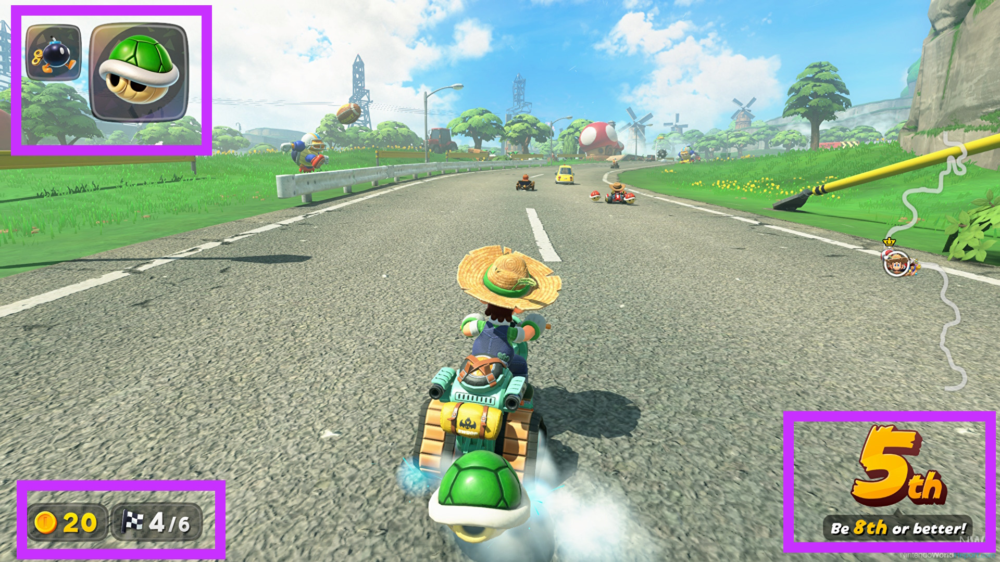
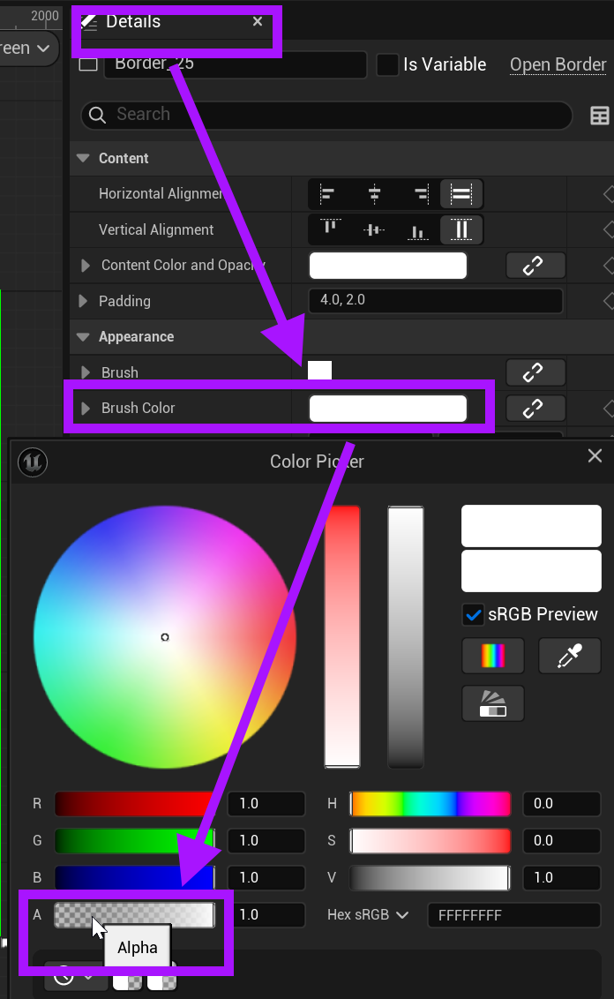
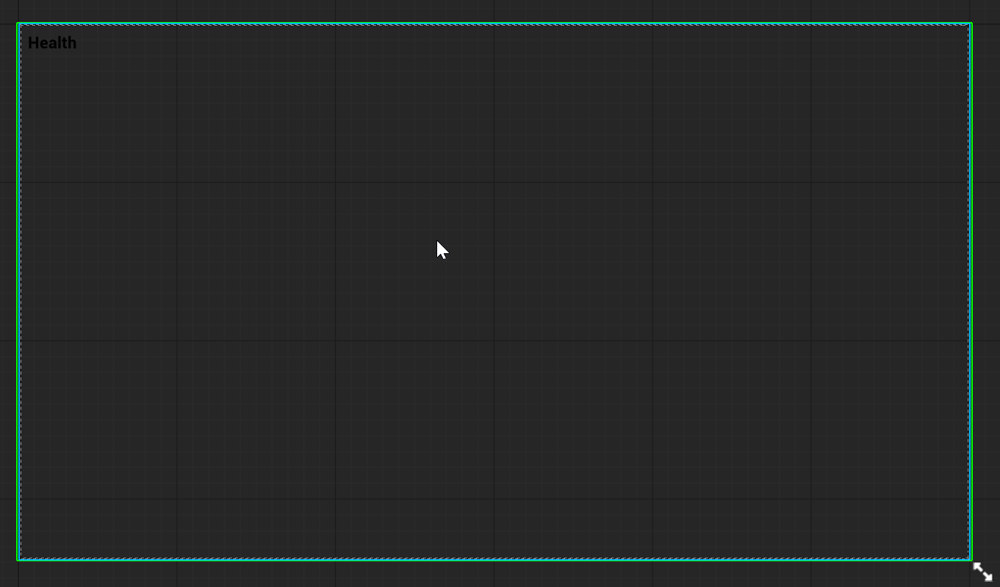
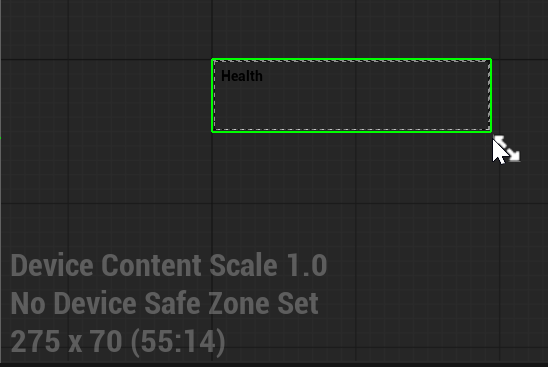

# Unreal: Widgets: Create a Heads-Up Display (HUD)

> Legacy lesson, organized for self-study. Screenshots may show an older editor. See the Unreal 5.8 verification scope (legacy attachment omitted) before relying on version-specific steps.

Many games have a heads-up display (HUD) to show the player information about the player character, space they are exploring, or some combination of both of these things.

In *Mario Kart World* (2025), for example, there are multiple corners of the screen showing information for the player:

*Figure: Screenshot of Mario Kart World showing HUD information.*

If we want some similar in Unreal, we want a Widget Blueprint added to the Viewport.

We also want at least one *bound* Widget values connected to some variable.

## *What's a HUD?*

We have two choices as it comes to a HUD for players.

The first is to create a full-screen Widget and adjust the border. The second is to resize a Widget to a small section.

### Full-Screen Widget with Low Brush Color Alpha

After adding a Border, adjust the Brush Color. For the Alpha turn it down to the lowest level, allowing us to "see" through the Widget.

*Figure: Screenshot showing use of Brush Color and Adjusting Alpha.*

If the *Brush Color* alpha value is at the lowest, it will be functionally invisible.

*Figure: Screenshot showing a full-screen widget with low alpha brush color value.*

## Re-sized Widget

This option, re-sizing a widget, can be really useful for smaller widget usage.

In the Widget Editor window, we can grab the bottom, right-hand corner and drag it smaller.

*Figure: Screenshot of scaled down widget in the Widget Editor.*
