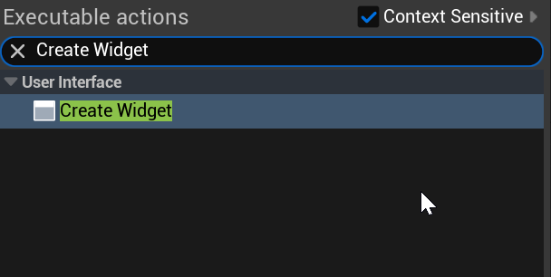
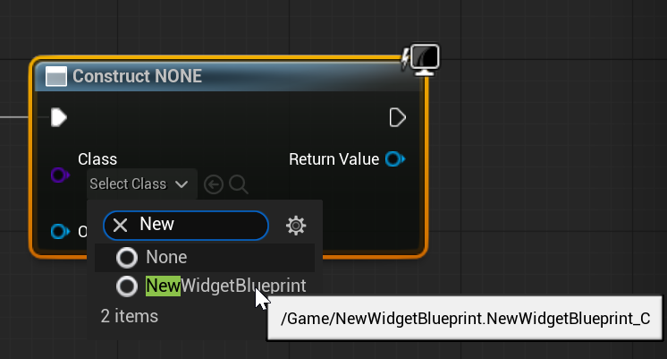
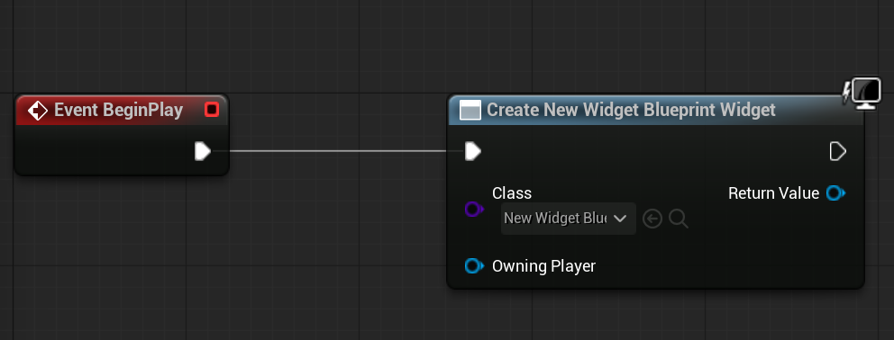
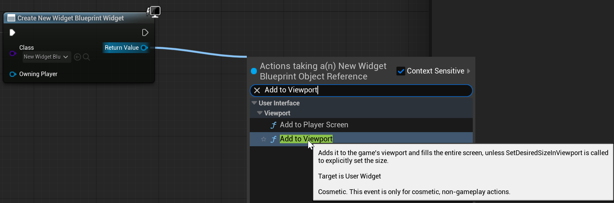
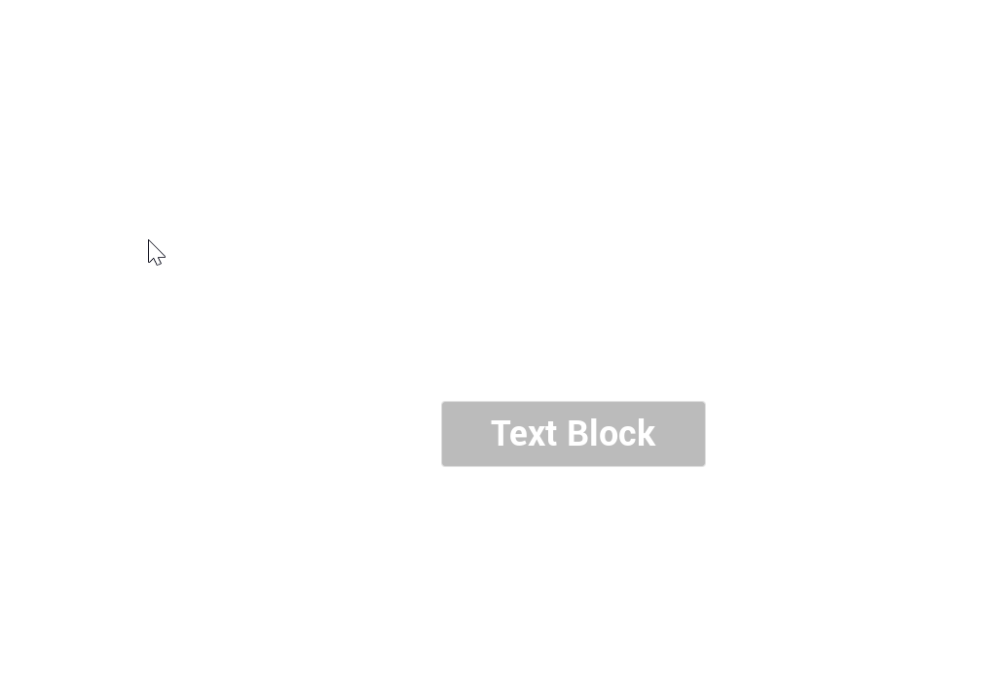

# Unreal: Widgets: Create Widgets + Adding to Viewport

> Legacy lesson, organized for self-study. Screenshots may show an older editor. See the Unreal 5.8 verification scope (legacy attachment omitted) before relying on version-specific steps.

With at least one Widget Blueprint created, it can be used in a level. We use a Widget Blueprint through two core actions:

- Create the Widget Blueprint
- Add the Spawned Blueprint to the Viewport

## *Wait. What's the Viewport?*

The **Viewport** is what the player view's the game through. It is the "port" used for viewing. Put another way, the Viewport is the center of the screen when working in the Unreal Editor.

## *How do we do this?*

Assuming there is a Widget Blueprint, let's go through the process:

First, use the "Create Widget" node.

*Figure: Screenshot of "Create Widget" node.*

In the *Select Class* drop-down, search for the name of a created Widget Blueprint.

*Figure: Screenshot showing the searched for created Widget Blueprint.*

Once the Blueprint has been selected, the name of the node will update.

*Figure: Screenshot showing the updated node name (as an example attached to the BeginPlay event).*

## Adding to Viewport

By dragging off the Return Value of the created node, search for **Add to Viewpoint**.

*Figure: Screenshot showing search for "Add to Viewport" from Return Value.*

When run, the created Widget Blueprint will be created and added to the Viewport.

*Figure: Screenshot of added Widget Blueprint to Viewport.*
