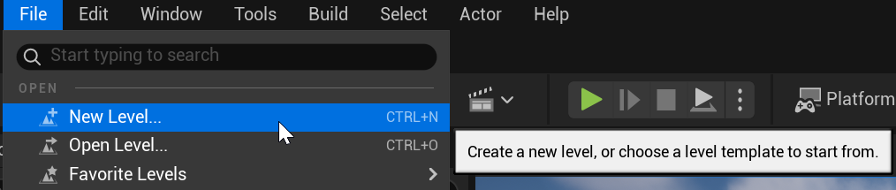
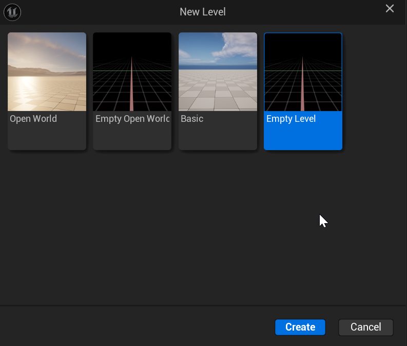
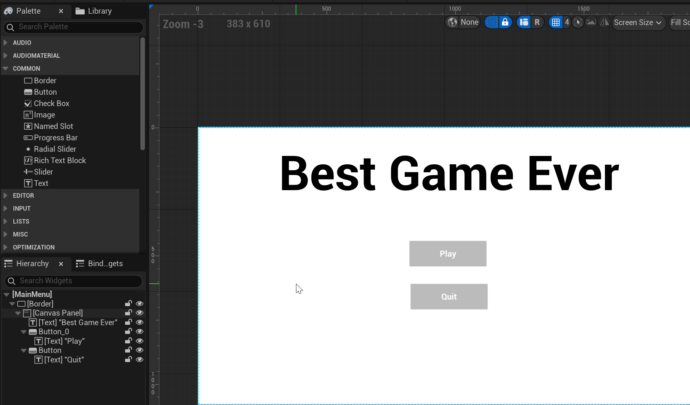
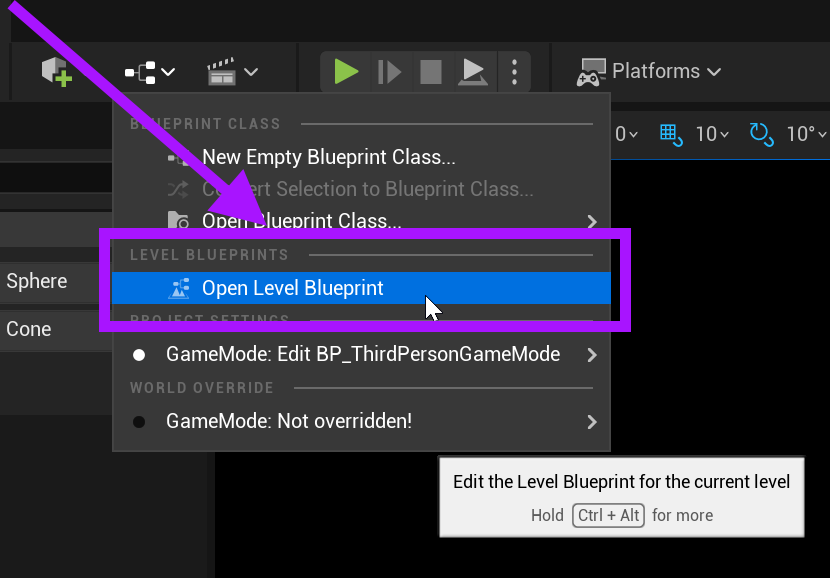
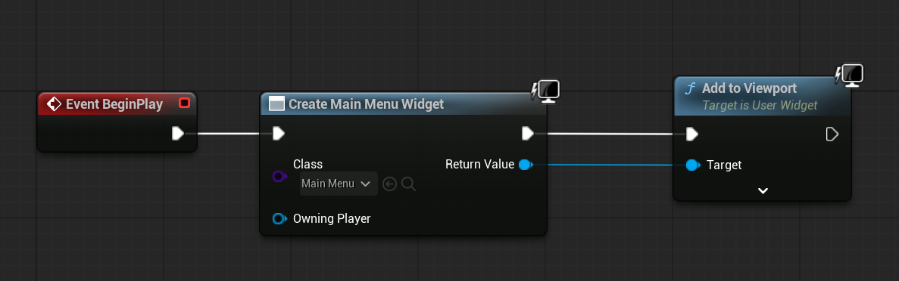
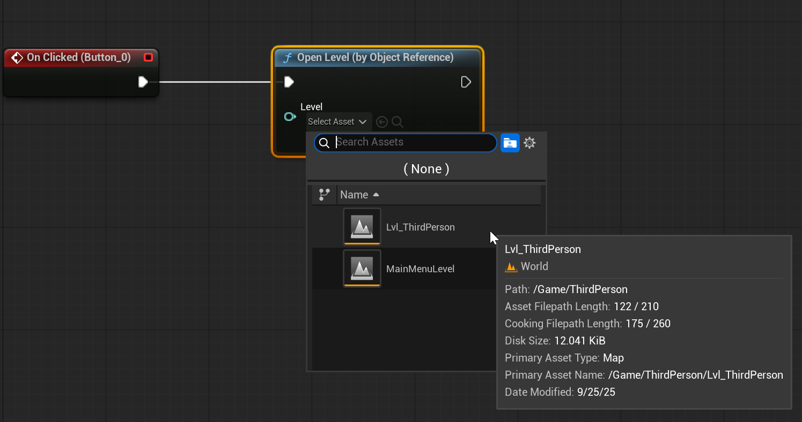

# Unreal: Widgets: Creating "Main Menu" Level with Widgets

> Legacy lesson, organized for self-study. Screenshots may show an older editor. See the Unreal 5.8 verification scope (legacy attachment omitted) before relying on version-specific steps.

## Creating a New Level

For creating a Main Menu, it is highly advised to create a new level to hold this menu.

*Figure: Screenshot showing File -\> New Level... option.*

When given an option, choose "Empty Level"

*Figure: Screenshot showing the Empty Level option for creating a new level.*

## Making a Main Menu

Make a new Widget Blueprint.

This may include Text and Buttons.

For example, here's one with a larger Text and two Buttons.

*Figure: Screenshot of a created "main menu" widget with Text and Buttons.*

With a Widget Blueprint created, we will move on to the standard process of creating the widget and adding it to the Viewport. This time, we are going to use something different, the Level Blueprint.

Every Level has it sown Blueprint. When editing a Level, this can be opened from the Blueprint menu.

*Figure: Screenshot of "Open Level Blueprint" option.*

In the Level Blueprint, we will use the same sequence we have used for other widgets.

*Figure: Screenshot showing the sequence for creating a widget + add to Viewport.*

## Optionally, Open Level based on Button Clicking

To finish out the example Main Menu, we can use the Open Level (By Object Reference) node. This allows us to open -- override current level -- another level. Think of this as moving us to another level.

*Figure: Screenshot showing the use of the On Clicked -\> Open Level (by Object Reference) nodes.*
