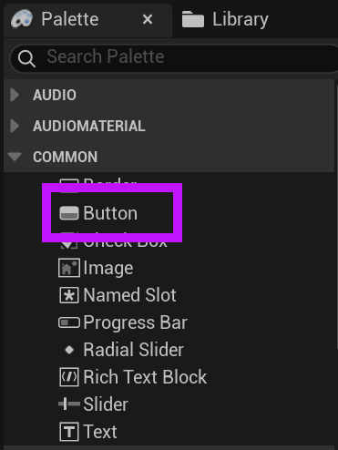
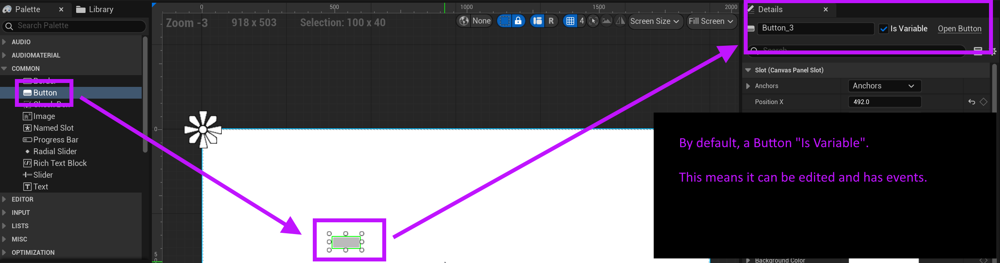
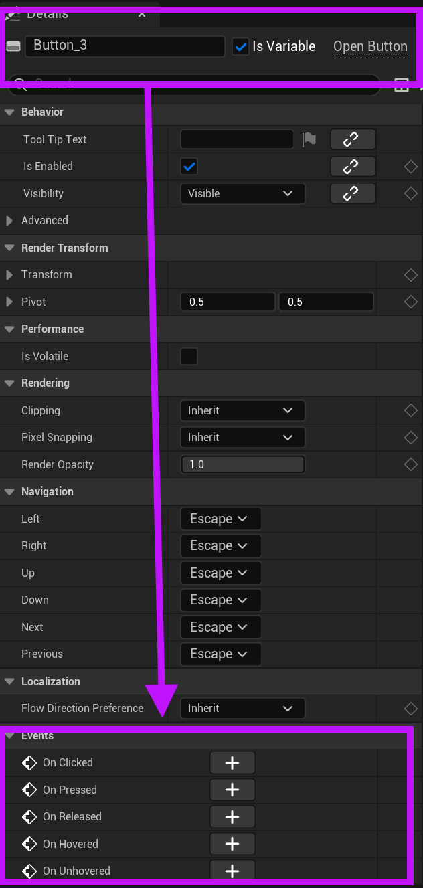
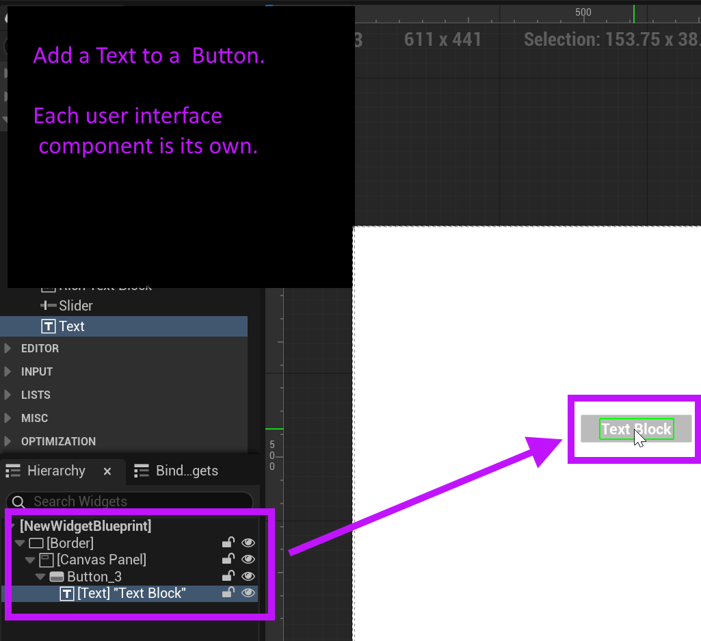

# Unreal: Widgets: Designer: Adding Buttons (on Panels on Border)

> Legacy lesson, organized for self-study. Screenshots may show an older editor. See the Unreal 5.8 verification scope (legacy attachment omitted) before relying on version-specific steps.

Very commonly a menu or other user interface will have buttons. When editing in Unreal, they are user the Common category.

*Figure: Screenshot of highlighted "Button" component.*

(Remember, we often add Buttons on a Panel, which is itself often on a Border.)

*Figure: Screenshot of adding a Button and its default "Is Variable".*

## *What is "Is Variable"?*

Many interactive components, like a Button, are marked as "Is Variable". When something is marked as this, it enables changing its values *and* allows us to access its events.

In fact, each button has its own set of default events. Scrolling down in the Detail tab shows these events.

*Figure: Screenshot highlighting the default events of a Button.*

## *Where's my text?!*

If you are coming from other user interfaces like Unity, you may be used to seeing Text on Buttons. In Unreal, this is *not* the default.

If we want text, we need to add a Text component onto a Button component.

*Figure: Screenshot showing the relationship between Button and Text user interface components.*
