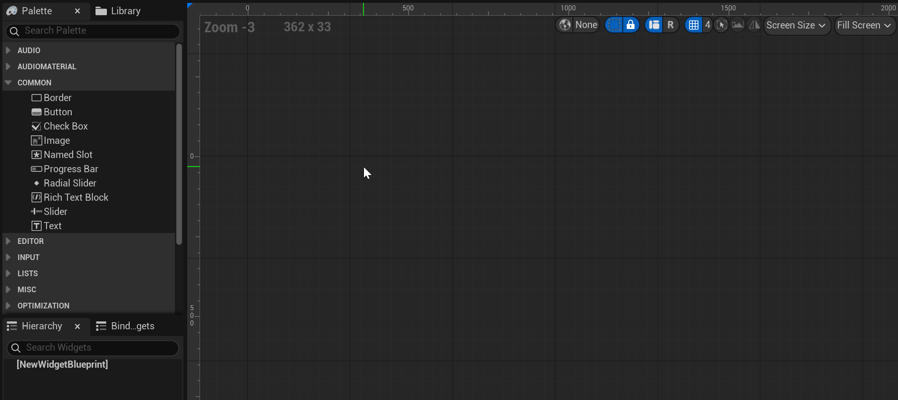
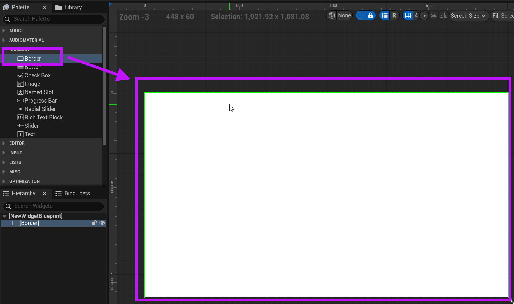
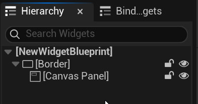

# Unreal: Widgets: Designer: Using Designer Mode

> Legacy lesson, organized for self-study. Screenshots may show an older editor. See the Unreal 5.8 verification scope (legacy attachment omitted) before relying on version-specific steps.

When we edit a Widget Blueprint, we can use one of two modes. The first, Designer, allows us to arranging user interface elements. The second, Graph, allows us to program those user interface elements.

By default, we open in Designer mode.

*Figure: Screenshot of the Designer mode when editing a Widget Blueprint.*

We can drag and drop components from the Palette tab (left-hand side) onto the Viewport (the middle).

Often, for example, we begin with a Border.

*Figure: Screenshot of result from dragging and dropping a Border component onto the Viewport.*

Following a Border, we often use a Panel.

(In this example, I used a Canvas Panel.)

With a panel added inside a Border, the Hierachy tab will show the relationship updates.

*Figure: Screenshot of updated relationship of Border containing a Canvas Panel.*
