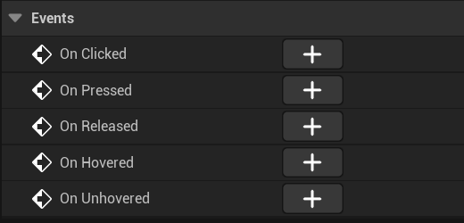
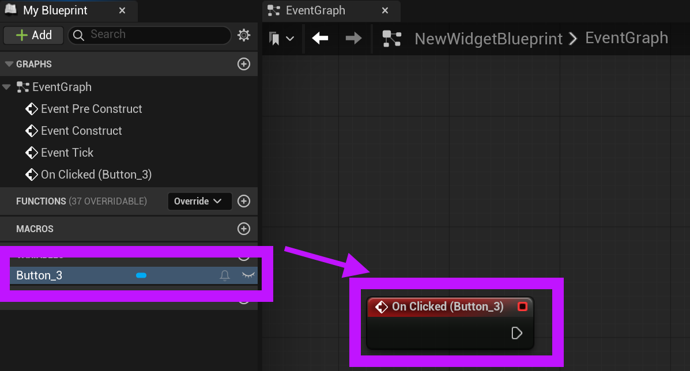

# Unreal: Widgets: Graph: (Is Variable) Events

> Legacy lesson, organized for self-study. Screenshots may show an older editor. See the Unreal 5.8 verification scope (legacy attachment omitted) before relying on version-specific steps.

If a user interface component is marked as "Is Variable", this allows us to access its events.

*Figure: Screenshot showing events for an example Button.*

If a user interface component is a "variable," it can be accessed in the Graph mode directly.

If, for example, we add an "On Click" event, this sends us to the Graph mode.

*Figure: Screenshot highlighting adding an "On Click" event to a Button.*
