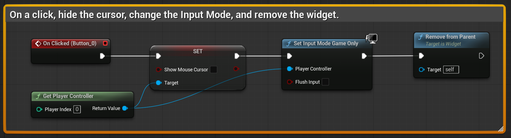

# Unreal: Widgets: Remove Menu, Hide Cursor, Set Input Mode

> Legacy lesson, organized for self-study. Screenshots may show an older editor. See the Unreal 5.8 verification scope (legacy attachment omitted) before relying on version-specific steps.

As we have seen, once we add a widget to the Viewport, it sticks around. Often, we want, with a Main Menu, to remove it later as part of some interaction.

Every Widget has a "parent." This is the Viewport. There is a node named **Remove from Parent**.

*Figure: Screenshot of sequence to remove the widget after a click.*

Commonly, we will want these same actions in sequence:

- Hide Cursor
- Change Input Mode
- Remove from Parent (the widget).

While we can flip the first and second action, the last must come at the end, as it will remove the widget itself.
