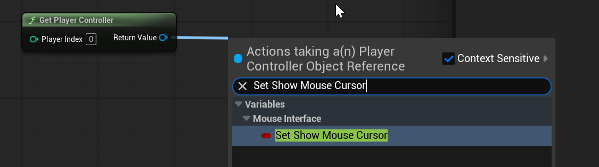
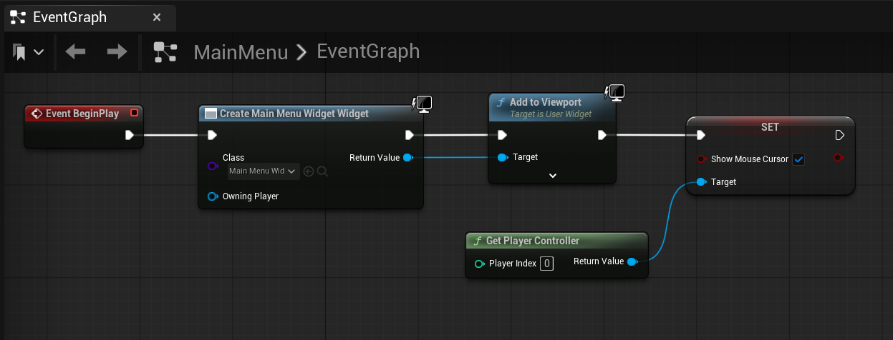
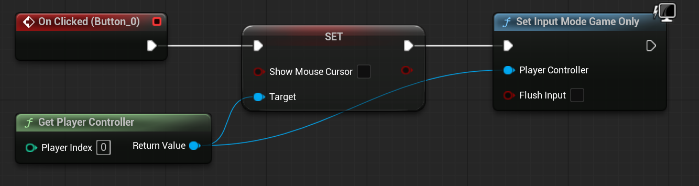

# Unreal: Widgets: Show and Hide Cursor

> Legacy lesson, organized for self-study. Screenshots may show an older editor. See the Unreal 5.8 verification scope (legacy attachment omitted) before relying on version-specific steps.

## Show Cursor

The Player Controller *controls* all input sources. This includes a useful node named **Show Mouse Cursor**.

*Figure: Screenshot of Set Show Mouse Cursor.*

As part of a sequence, we would add the cursor back as part of spawning a "Main Menu" widget:

*Figure: Screenshot of a sequence of nodes ending in showing the mouse cursor.*

## Hide Cursor (and Switch Input Mode)

*Figure: Screenshot of sequence in Widget ending with Set Input Mode Game Only.*
