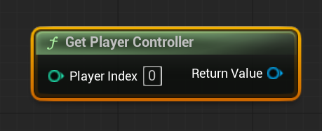
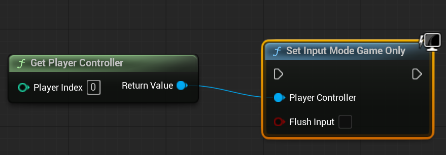
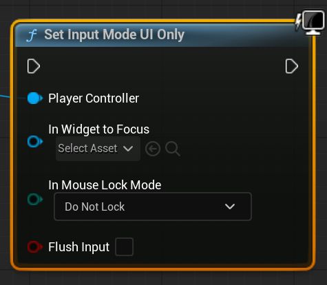
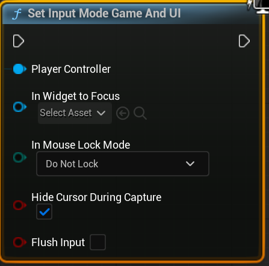

# Unreal: Widgets: What are Input Modes?

> Legacy lesson, organized for self-study. Screenshots may show an older editor. See the Unreal 5.8 verification scope (legacy attachment omitted) before relying on version-specific steps.

Unreal understands there may be times where a player wants to control a character on a screen and others where they may want to control options within a menu. With these two in mind, Unreal has input modes divided between them: Game, UI, and Game and UI.

## *Why would I want to switch input mode?*

There are times where a player may want to use their physical controller to move a character and others to move between menu options. To avoid situations where "input" might be split between them, Unreal allows designers to switch the input toward a different mode and ignore the other as needed.

## *Where is the input coming from?*

When working with input modes, Unreal always needs to know where input is coming from for the input mode. In nearly every situation, this is Player Controller using the node "Get Player Controller". This will allow the player to interact with widgets.

*Figure: Screenshot of "Get Player Controller" node.*

## *Which input mode do you want?*

There are three modes, each with their own nodes:

Input Mode Nodes

<table>
<colgroup>
<col style="width: 33%" />
<col style="width: 33%" />
<col style="width: 33%" />
</colgroup>
<tbody>
<tr>
<th>
<strong>Set Input Mode Game Only</strong>
</th>
<th>
<strong>Set Input Mode UI Only</strong>
</th>
<th>
<strong>Set Input Mode Game and UI</strong>
</th>
</tr>
&#10;<tr>
<td>

<em>Figure: Screenshot Set Input Mode Game Only</em>
</td>
<td>

<em>Figure: Screenshot of Set Input Mode UI Only</em>
</td>
<td>

<em>Figure: Screenshot of Set Input Model Game And UI</em>
</td>
</tr>
</tbody>
</table>
