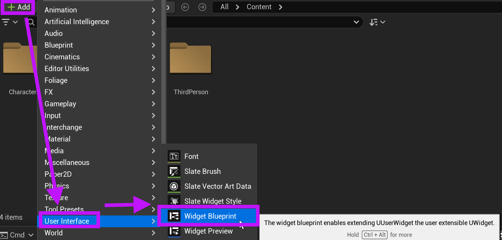
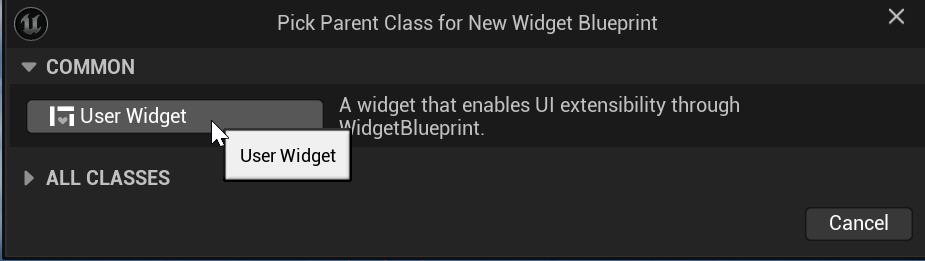
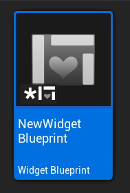
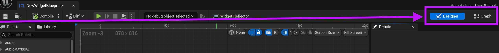

# Unreal: Widgets: What is a Widget?

> Legacy lesson, organized for self-study. Screenshots may show an older editor. See the Unreal 5.8 verification scope (legacy attachment omitted) before relying on version-specific steps.

**A Widget is a collection of user interface elements.** When we want to show user interface elements common to video game such as a health or magic bar, we are, in the terms of Unreal, using **widgets**.

Everything in Unreal is a blueprint. This is also true of **Widget**. As we work with them, we can use programming, and what we know from inter-actor communication, to exchange data between widgets and other actors.

## A Widget Blueprint starts as a Blueprint

Unlike many other actors and functionality we have seen so far, a **Widget Blueprint** begins as a Blueprint and is then dynamically created as part of some process. Think of pressing a button on a controller and a menu appearing. Until the event of pressing a button happens, the widget did not exist. It is created as needed.

## Creating a Widget

A new **Widget Blueprint** can be created by using the Add/Import button or right-click menu in the Content Browser within the Content Drawer. Selecting User Interface -\> Widget Blueprint will create a new widget blueprint.

*Legacy remote illustration omitted.*

*Figure: Screenshot highlighting the process of adding a new Widget Blueprint.*

Because a **Widget Blueprint** is based on existing sets of values (classes), Unreal gives designers a choice when creating a new blueprint:

*Legacy remote illustration omitted.*

*Figure: Screenshot of "Pick Parent Class for New Widget Blueprint" window showing "User Widget" button.*

Choosing the default "User Widget" (by clicking on the label), we create a new **Widget Blueprint** in the Content Drawer.

*Figure: Screenshot of created Widget Blueprint asset.*

## Editing a Widget

Double-clicking a **Widget Blueprint** file in the Content Drawer will open it in the Widget Blueprint Editor. This allows for changing the arrangement of user interface elements and updating nodes in its Event Graph.

Because a widgets are both a visual representation (such as a bar, button, or some other element) and some programming, the Widget Blueprint Editor has two modes: Blueprint Designer and Graph Editing. These can be found in the upper, right-hand corner:

*Legacy remote illustration omitted.*

*Figure: Screenshot showing the "Designer" and "Graph" modes when editing a Widget Blueprint.*

Using the Blueprint Designer mode allows for visually arranging elements and the Graph Editing mode allows for scripting interactions based on a player doing things like clicking buttons or otherwise interacting with some element.
