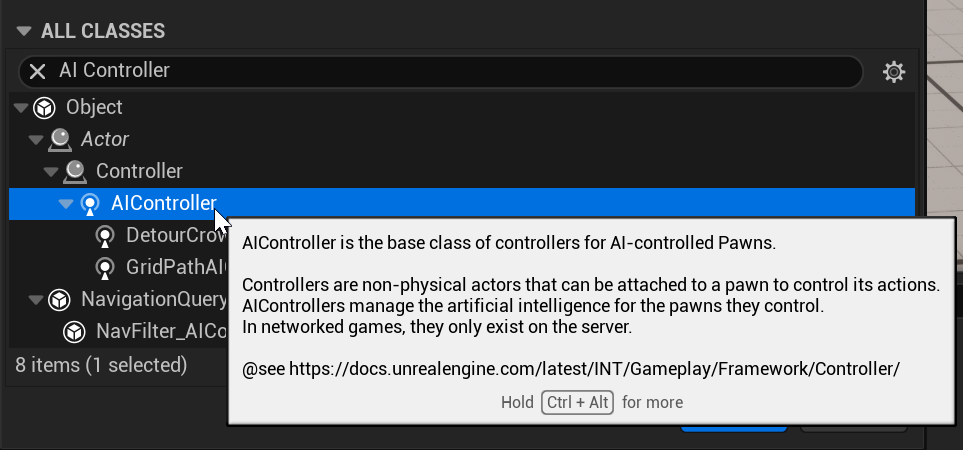
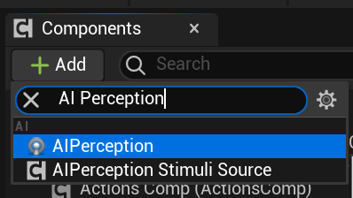
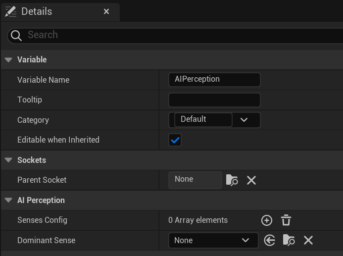
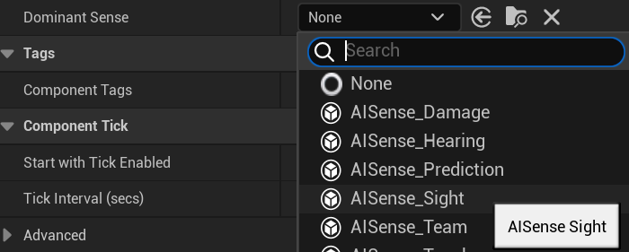
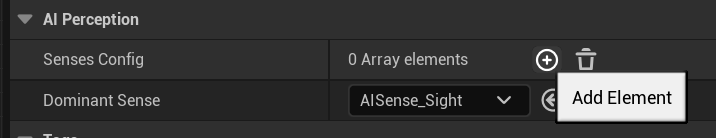
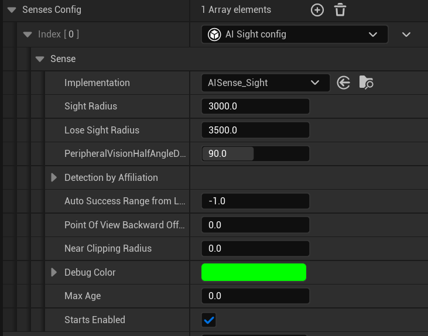
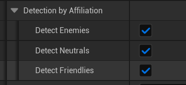

# Unreal: AI: AI Controller: Adding AI Controller

> Legacy lesson, organized for self-study. Screenshots may show an older editor. See the Unreal 5.8 verification scope (legacy attachment omitted) before relying on version-specific steps.

It can be tempting to think we can use many different collision shapes as part of a character moving around in a space to do things like detect if a player-character is near them, but Unreal has a better solution to the problem of perception: a component named AI Perception. To understand this component, we first need to start with an connected idea, AI Controller, and build our way back up.

## Creating our own Controller "brain"

When we control the Third Person or First Person characters in those templates, we are providing the "brain" for its movement by using Player Controller. The same is also true of the Character blueprint. If we want the character we have created to act according to some rules we create, we have to create our own "brain" for it. This means creating a new AI Controller blueprint.

In the Content Drawer, click on "+Add" (or right-clicking) and then Blueprint Class.

Like with Game Instance, we need to create a new blueprint based on the class of the same name. Search for "AI Controller"

*Figure: Screenshot of searching for AI Controller.*

Name the new AI Controller Blueprint "NPC_Brain".

Double-click on it to open it.

Under the Components, click on "Add" and then search for "AI Perception":

*Figure: Screenshot showing search for "AI Perception" component.*

Click to add this component to the controller blueprint.

Why did we add the AI Perception component to the AI Controller? For humans, in order to understand perception, signals have to be processed by our brains. This is also true of the metaphor setup of the AI Controller and AI Perception. In order to perceive, it has to happen as part of the "brain," the AI Controller blueprint.

## Understanding Video Game Perception

When we use the term **perception** in video games, we are discussing something very different than our human senses. When we see something, we are processing the reflection of light off a surface into our eyes. In video games, light does not exist as an energy force in the same way. What we perceive of light, shadows, and other digital objects is an illusion creating something we think is three-dimensional looking, but is not.

**In video games, perception describes relationship on if one things, an actor in Unreal, can detect another actor.** Developers behind Unreal have simplified this process significantly through the AI Perception component. By setting up what ‘sense’ we want (and we will use sight most often), we can define how one actor can perceive another.

## Configuring AI Perception

Clicking on the AI Perception component shows a number of different options as part of its Details:

*Figure: Screenshot of AI Perception section.*

For this specific example, we care most about the AI Perception options because we need to configure the dominant sense (which will be ‘sight’ for this example) and then the ranges of that perception.

First, for the drop down for Dominant Sense, select "AISense_Sight":

*Figure: Search for "AISense_Sight"*

Next, click on the plus symbol next to the Sense Config array:

*Figure: Add Sense Config entry.*

Click on the side arrow to show the first index and, for its drop down, select "AI Sight config":

*Figure: AI_Sight Default Values.*

By default, this use of perception can see anything within 3000 Unreal units of itself within 90 (half-degree) of its facing. In other words, it can detect the movement into (like with begin overlap) and out of (like with end overlap) its perception range.

There is one more thing to change.

Under "Detection By Affiliation", make sure all the categories are clicked:

*Figure: Detection by Affiliation*

For right now, we want the enemy to perceive everything. (Later, if we want, we can filter this down to different things.)

Compile the changes.

Save the changes. (File → Save.)
