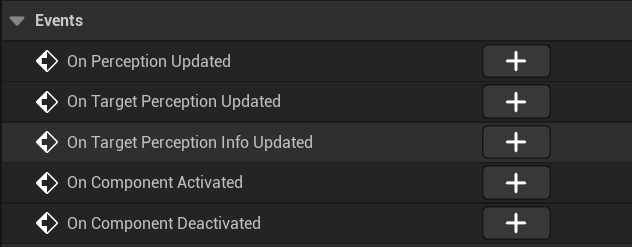
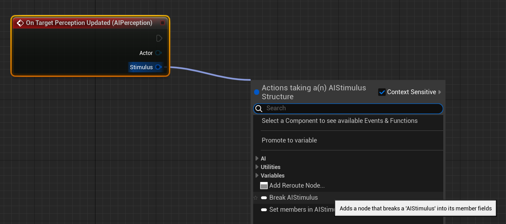
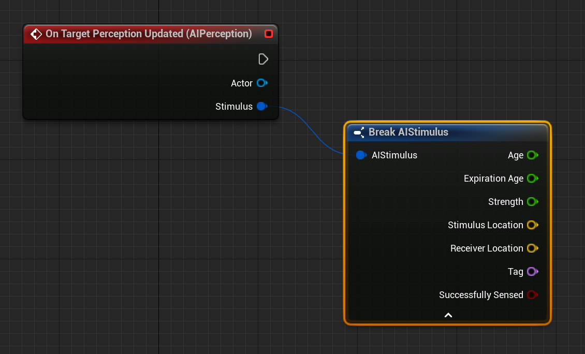
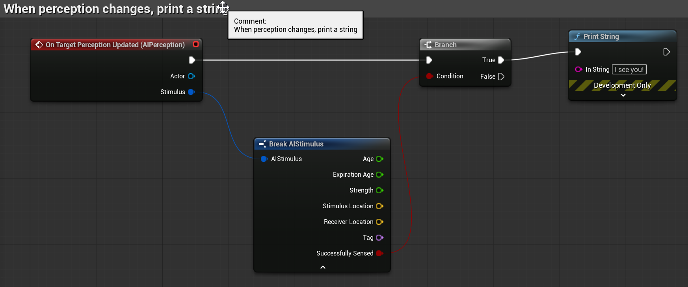

# Unreal: AI: AI Controller: Detecting a Perception Change

> Legacy lesson, organized for self-study. Screenshots may show an older editor. See the Unreal 5.8 verification scope (legacy attachment omitted) before relying on version-specific steps.

Like with any component, AI Perception has its own events:

*Figure: Perception Events.*

For this specific example, click on the plus symbol next to "On Target Perception Updated".

The "Target Perception Updated" event happens because of two reasons:

- A target has entered the perception range.

<!-- -->

- A target has left the perception range.

When a perception change happens, information about the perception is kept inside a data structure named a Stimulus. This contains information about where the perception happened, how long ago, and if the perception was successful (if something entered instead of exited).

Drag off Stimulus and Unreal will show a possible option as "Break AIStimulus". Click on this:

*Figure: Using Break AI Stimulus.*

Click on the arrow to show the full set of options:

*Figure: Connection between Updated and Break AI Stimulus.*

We want the last one, "Successfully Sensed". If something has entered, this will be true. (Else, it is false).

Dragging off this, create a Branch node.

Make a link between the event and Branch nodes.

Drag off the True output pin of the Branch node and search for Print String.

Set the string to show to "I see you!"

*Figure: Screenshot of completed sequence of nodes.*

In the new code, the event Target Perception Updated will trigger when something enters or leaves the perception range. If it enters, Successfully Sensed will be true. When it is true, as processed by the Branch node, the message "I see you!" will be shown to the player.

Compile the changes.

Save the changes. (File → Save.)
