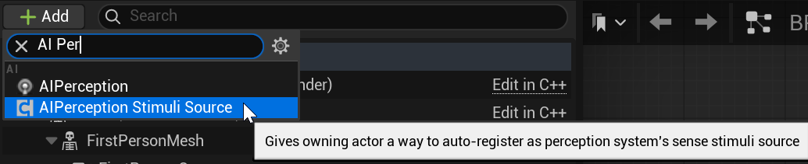
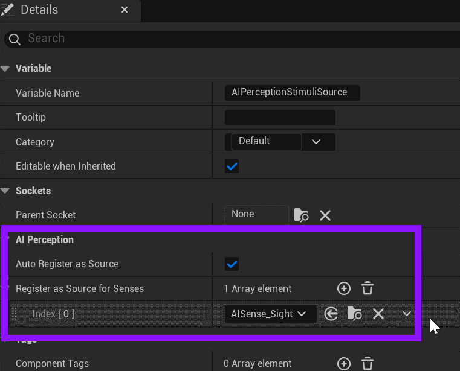

# Unreal: AI: AI Controller: Detecting a Stimulus

> Legacy lesson, organized for self-study. Screenshots may show an older editor. See the Unreal 5.8 verification scope (legacy attachment omitted) before relying on version-specific steps.

The AI Perception component needs to know from where it is getting "stimulus."

For whatever we want the AI Perception to detect, we need to add a component.

(If you are using the Third Person or First Person, add the stimuli component to it.)

*Figure: Adding AI Perception Stumuli Source.*

In the Detail tab of the component, adjust what it is serving as a perception for within the level.

(In this example, Sight is used as the primary sense.)

*Figure: Screenshot showing AI Perception settings.*
