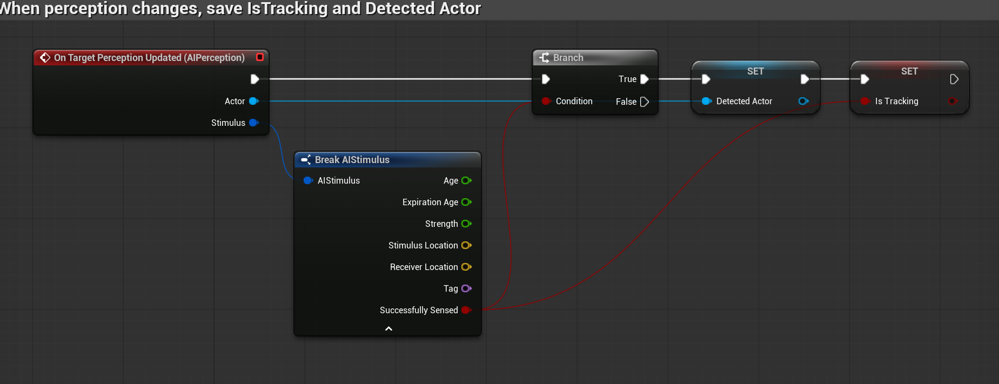
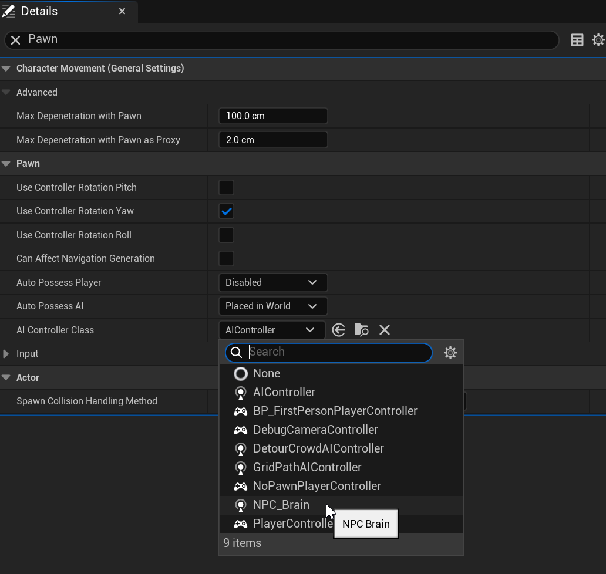
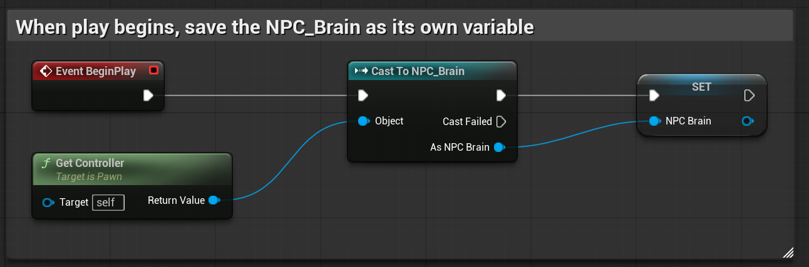
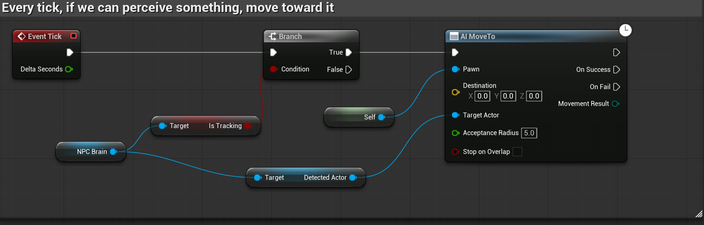

# Unreal: AI: AI Controller: Understanding connection between AI Controller ("Brain") and Character

> Legacy lesson, organized for self-study. Screenshots may show an older editor. See the Unreal 5.8 verification scope (legacy attachment omitted) before relying on version-specific steps.

Previously, we created an AI Controller Blueprint. What we want to do is save a variable in the AI Controller on if we are tracking something (Boolean) and what we are tracking (Actor). Both of these need to be Instance Editable (made public) to access them in another Blueprint.

In the Character, which "has" the AI Controller, we want to access these variables.

Let's look at an example.

## Sequence in AI Controller

*Figure: Screenshot of completed sequence node saving two variables.*

## Sequence in Character

First, make sure the Character is using the new AI Controller class.

Make sure the Character class is open in the Blueprints editor.

In the Details tab, search for "Pawn" and find the AI Controller Class.

Using the menu, select the new AI Controller class. (In my example, I have named it "NPC_Brain".)

*Figure: Selecting AI Controller class in Blueprints.*

Because we are using our own class, we need the Cast To node. We will do this as part of Begin Play.

*Figure: Screenshot of saving the Cast To node at the start of play.*

Building off the AI Move To (which needs a Nav Mesh), we can check if the Character perceives and then "chase" it using the node.

*Figure: Screenshot of sequence of nodes based on NPC Brain.*
