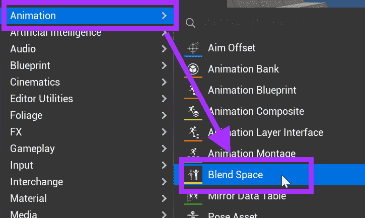
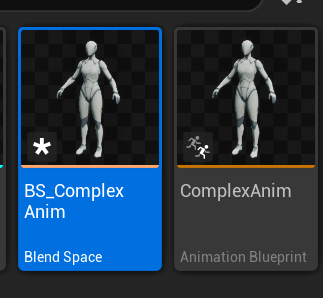
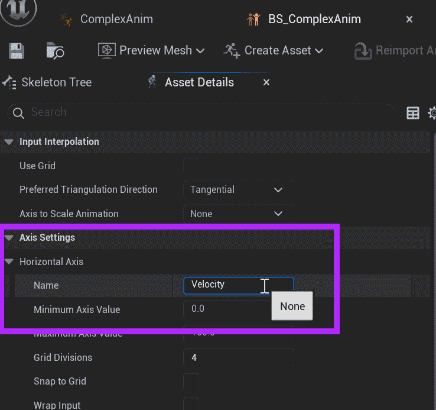
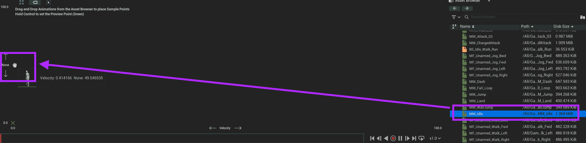
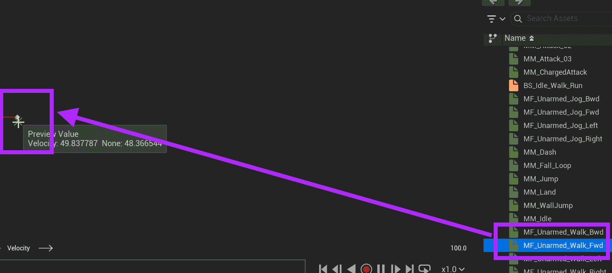
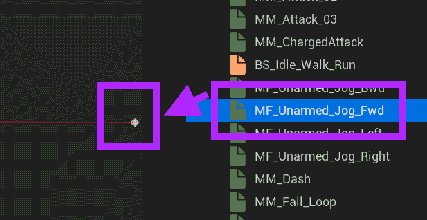

# Unreal: Animations: Blend Spaces: Example: (2) Preparing Blend Space

> Legacy lesson, organized for self-study. Screenshots may show an older editor. See the Unreal 5.8 verification scope (legacy attachment omitted) before relying on version-specific steps.

Go back to Unreal.

## Create a Blend Space

In the Content Drawer, click on Add.

From Animation, go to Blend Space.

*Figure: Screenshot highlighting Animation -\> Blend Space.*

Name this Blend Space "BS_ComplexAnim"

*Figure: Screenshot of created Blend Space and Animation Blueprint.*

Double-click on the Blend Space to open it.

Unreal does not use names for the each axis. They are "None". To help us make more sense of them, we need to add a name.

Under the Asset Details panel on the left-hand side, find Axis Settings → Horizontal Axis.

Change the name to "Velocity":

*Figure: Screenshot highlighting the Axis Settings -\> Horizontal Axis -\> Name: Velocity.*

Now, the horizontal axis will be labelled "Velocity".

To begin to blend across animations, we need to think about when we want them to be used. Back when we were thinking through the rules for the animation state machine, we established two:

- When velocity is below 10, play Idle.
- When velocity is above 10, play Walk.

With using a blend space, we can use multiple animations based on a range of values.

Consider the following range spread across Idle, Walk, and Running:

- 0: Idle
- 50: Walk
- 100: Running

Let's implement those changes.

## Adding States (Animations) at Intersections

Find the MM_Idle animation in the Asset Browser.

Drag and drop the animation (which will appear as a dot) at the middle, left-most range.

*Figure: Screenshot highlighting the dragging and dropping of the MM_Idle animation.*

The states we will be adding will act as an internal state machine. Along a single axis (velocity), Unreal will blend the animation based on where they appear along the axis. Right now, we are positioning the Idle animation.

Next, we need the Walk.

We will use the Unarmed_Walk_Fwd.

Drag and drop this into the middle of the axis.

*Figure: Screenshot highlighting the dragging and dropping of the Unarmed_Walk_Fwd animation.*

Finally, let's add MF_Unarmed_Jog_Fwd on the far right end of the axis.

*Figure: Screenshot highlighting the MF_Unarmed_Jog_Fwd dragged and dropped at the end of the axis.*

In the new axis, there are three states arranged along a single axis. Based on the value, Unreal will blend the animations across Idle, Walk, and Jog.

Hold CTRL and drag the cursor across the axis to see this change. Depending on the location along the axis, different parts of an animation will be run.
