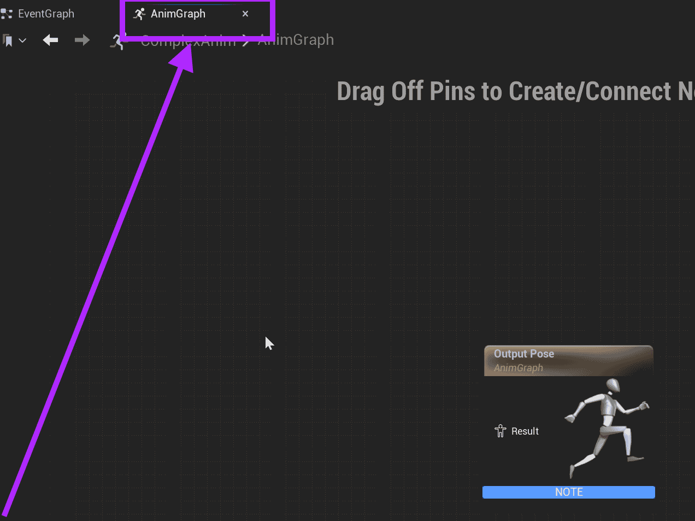
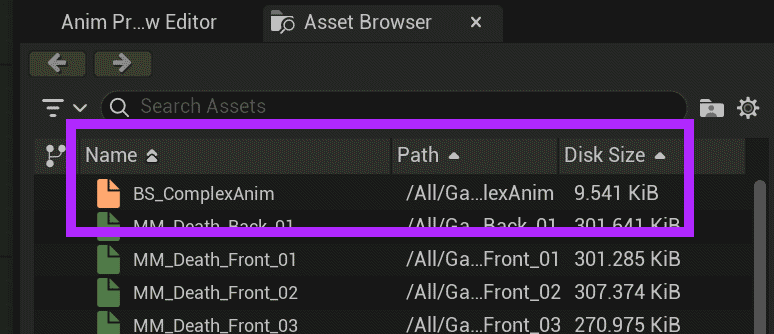
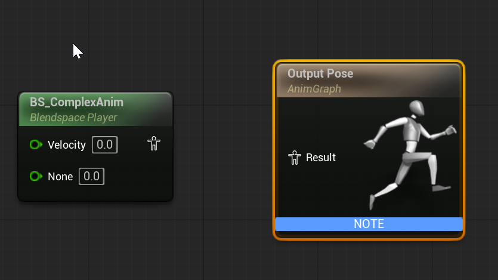
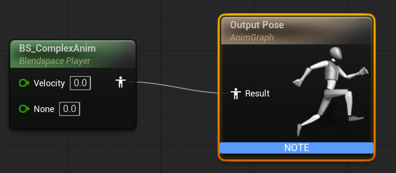
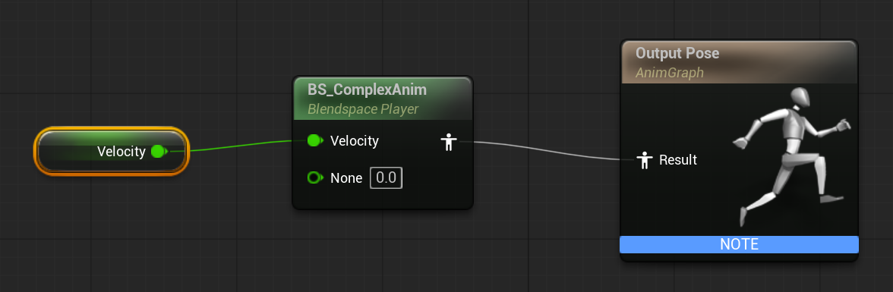
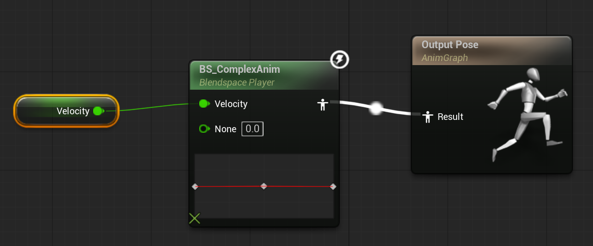

# Unreal: Animations: Blend Spaces: Example: (3) Connect Blend Space to Animation Graph

> Legacy lesson, organized for self-study. Screenshots may show an older editor. See the Unreal 5.8 verification scope (legacy attachment omitted) before relying on version-specific steps.

We now have a Animation Graph and a Blend Space. We want to connect these together.

Luckily, Animation Graph considers a Blend Space as an asset.

## Adding Blend Space to Anim Graph

Double-click the Animation Graph in the Content Drawer if not already open.

Move to the Anim Graph.

*Figure: Screenshot highlighting the AnimGraph.*

## Adding the Blend Space

Open the Asset Browser. (This is usually in the bottom, right-hand side.)

Find the previously-created Blend Space. (In this example, it is named BS_ComplexAnim.)

*Figure: Screenshot highlighting the BS_ComplexAnim asset.*

Drag and drop the BS_ComplexAnim asset onto the Anim Graph.

*Figure: Screenshot showing the BS_ComplexAnim and Output Pose nodes.*

Pull off the BS_ComplexAnim node output pin and connect it to the Output Pose.

*Figure: Screenshot showing the connection between Complex Anim and Output Pose.*

From the Variables (under My Blueprint) drag and drop the variable *Velocity*. We want to Get Velocity.

Pull off the Get Velocity node and connect it to the input pin of the BS_ComplexAnim node.

*Figure: Screenshot of node sequence from Get Velocity to ComplexAnim to Output Pose.*

Click COMPILE.

Once compiled, the axis will be shown and Unreal will highlight the flow from the Blend Space to the Output Pose.

Figure: Compiled node sequence.
