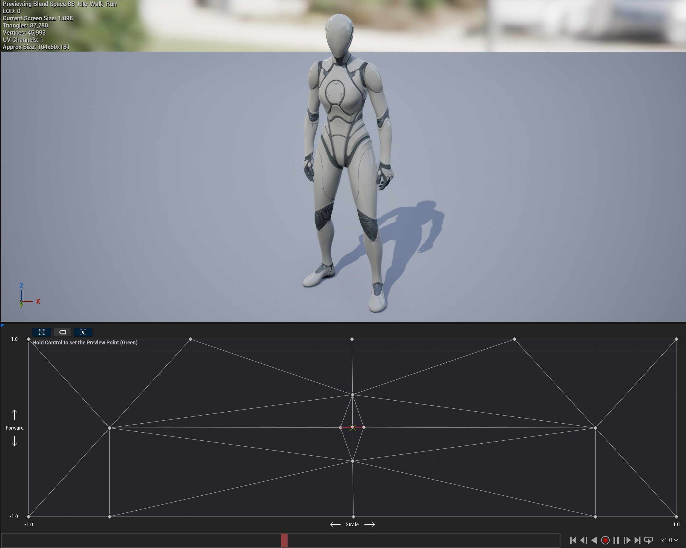

# Unreal: Animations: Blend Spaces: What is a blend space?

> Legacy lesson, organized for self-study. Screenshots may show an older editor. See the Unreal 5.8 verification scope (legacy attachment omitted) before relying on version-specific steps.

For many uses of animations in Unreal. we can define a state machine as we have already seen. However, if there will be multiple animations for something, like a player character, we can't use a simple state machine.

For more complex usages, we want a **[blend space](https://dev.epicgames.com/documentation/en-us/unreal-engine/blend-spaces-in-unreal-engine).** In Unreal, we can define multiple axis value ranges and the animation will "blend" the animation frames based on the "space" of their values.

## *Why would I want a blend space?*

A blend space allows us to connect multiple animations together, define some range for when they should run, and then let Unreal decide.

The default blend space (BS) of the Third Person character looks like the following:

*Figure: Screenshot of full blend space using Idle, Walk, Run, and Strife animations.*
