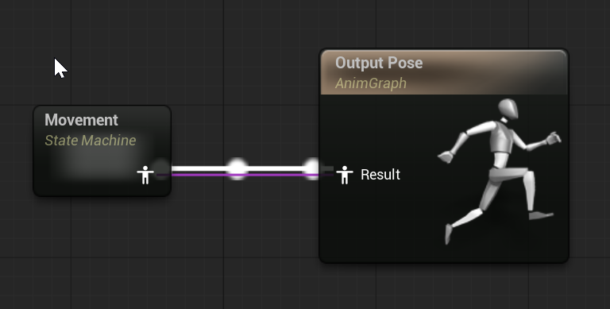
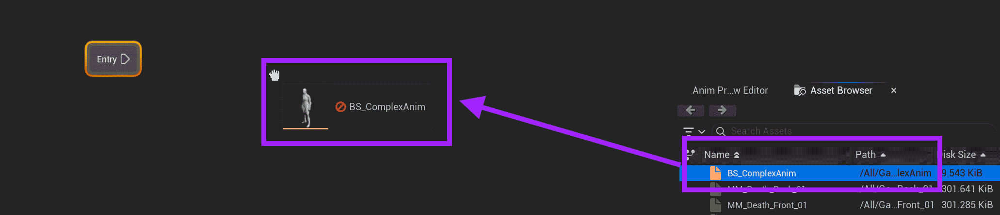
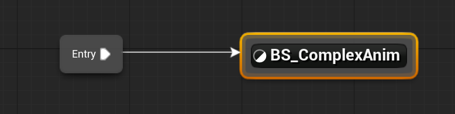
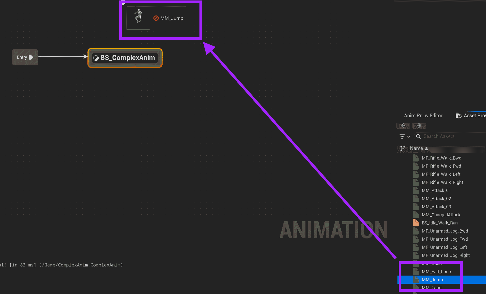
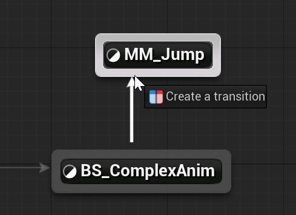
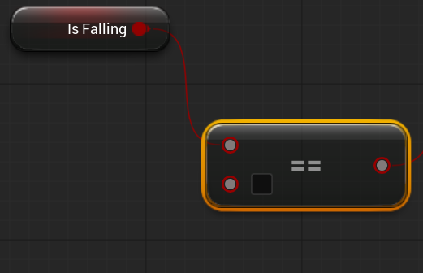
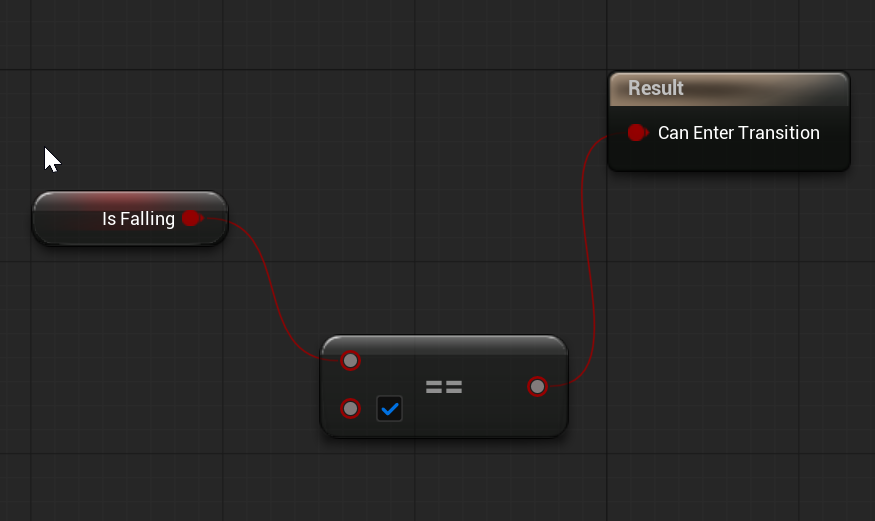
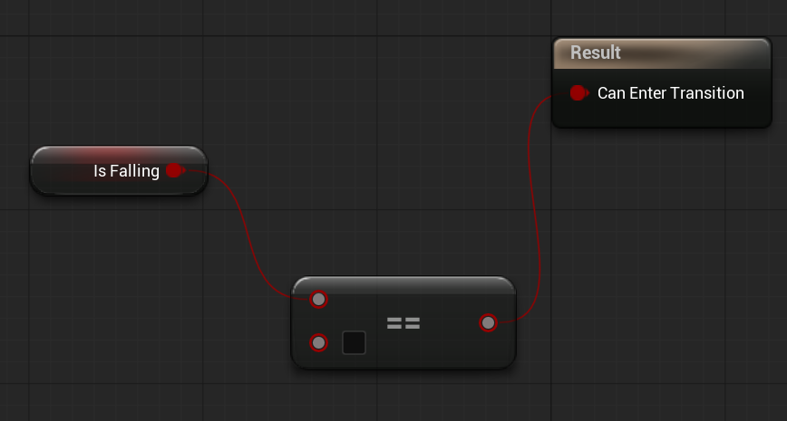
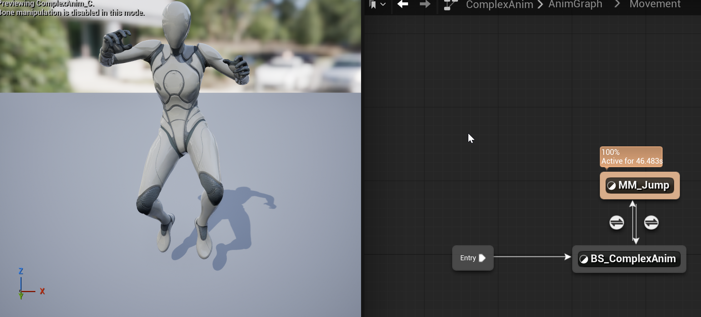
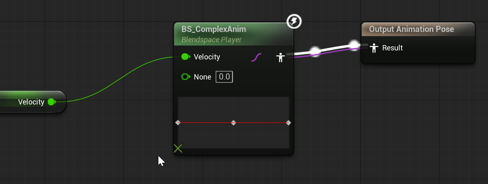

# Unreal: Animations: Example: Blend Space inside a State Machine

> Legacy lesson, organized for self-study. Screenshots may show an older editor. See the Unreal 5.8 verification scope (legacy attachment omitted) before relying on version-specific steps.

Return to the Anim Graph.

Previously, we had a Blend Space connected to the Output Pose. Erase these nodes.

Pull off the result of the Output Pose and create a State Machine named "Movement"

*Figure: Screenshot of Movement State Machine connected to AnimGraph Output Pose.*

Double-click the Movement State Machine to open it.

## Adding a Blend Space inside the State Machine

From the Asset Browser, drag and drop the previously created Blend Space.

*Figure: Screenshot of dragging and dropping created Blend Space.*

The added Blend Space will act as its own state for the State Machine.

Pull off the Entry state and connect it to the ComplexAnim state.

*Figure: Screenshot of connected state machine.*

From the Asset Browser, drag and drop the MM_Jump asset.

*Figure: Screenshot highlighting the dragging and dropping MM_Jump state.*

## Making Transitions

With both states added, pull off of Complex Anim and connect to MM_Jump.

*Figure: Screenshot of creating a transition between ComplexAnim and MM_Jump.*

Double-click on the created transition.

Drag and drop the Is Falling local variable. Get Is Falling.

Pull off the Get Is Falling node and search for "Is Equal"

Connect the Equal node to the Result node and check the value.

Figure: Screenshot of Equal node connected to Result.

What we have just created a condition.

If we are jumping, we are falling.

## Completing Transitions

Return to the Anim Graph.

Pull off from the MM_Jump state and connect it to the ComplexAnim state.

Double-click on the transition.

For this transition, we will follow the same general pattern.

The exception is that we want the box unchecked.

When we aren't jumping, we want to return to Blend Space.

*Figure: Screenshot showing comparison.*

When the transitions are ready, click COMPILE.

The animation will now "jump" and get stuck there.

*Figure: Screenshot of ComplexAnim to MM_Jump connection.*

This is correct based on what we have setup so far.

Return to the State Machine graph.

## Connecting Blend Space to *Velocity*

There is one more important step. We need to connect *Velocity* back to the Blend Space.

In the State Machine graph, double-click on the Blend Space.

Drag and drop the Velocity to use Get Velocity.

*Figure: Screenshot connecting Velocity to ComplexAnim Blend Space to Output.*

Finally, we are done.

Internally, the Event Graph will feed Velocity and Is Falling.

In the Anim Graph, we will use those values for either movement (across some axis) or jumping (based on *Is Falling*).
