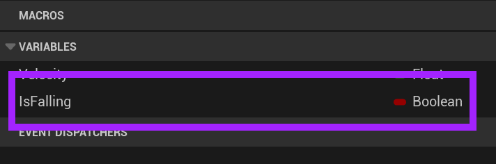
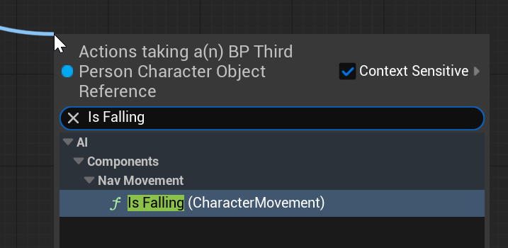
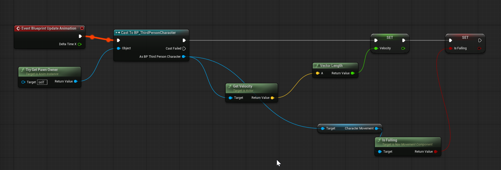

# Unreal: Animations: Example: Setting IsFalling in Anim Graph

> Legacy lesson, organized for self-study. Screenshots may show an older editor. See the Unreal 5.8 verification scope (legacy attachment omitted) before relying on version-specific steps.

The CharacterMovement component found inside of the Character class gives us access to a Node returning a Boolean value named **IsFalling**. What we want to do is extend our current sequence inside the Event Graph of the *ComplexAnim* to also set an internal value based on this value.

Create a new variable named *IsFalling* as part of the Anim Graph.

*Figure: Screenshot highlighting the IsFalling Anim Graph variable.*

Drag and drop IsFalling using Set IsFalling.

Pull off the Cast to node and search for "Is Falling"

*Figure: Screenshot of Is Falling search.*

Connect Is Falling to the Set Is Falling Node, creating the following sequence:

*Figure: Screenshot of completed sequence.*
