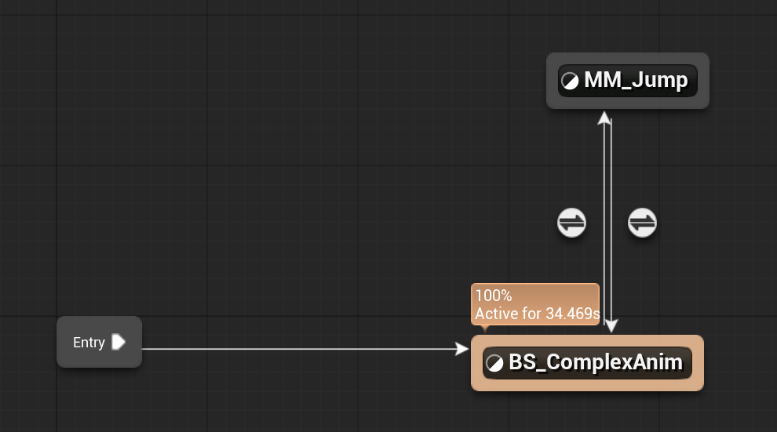

# Unreal: Animations: Example: What is a jump?

> Legacy lesson, organized for self-study. Screenshots may show an older editor. See the Unreal 5.8 verification scope (legacy attachment omitted) before relying on version-specific steps.

What exactly is a jump animation? It may seem strange to ask this, but the determination is important for understanding how a "Jump" relates to other movement. For Idle, Walk, and Jog, we can think of it as a change across an axis. As we have within a Blend Space, these are 0, half-way, and full amounts of some axis.

## *What, then, is a jump?*

If we think of a jump as an animation that can "interrupt" other animations, we need to go back to our state machine. We need to transition into a jump and then return back to the other movements.

If we are using transitions, we want a state machine. And, while it may seem strange at first, we can put a Blend Space inside a State Machine. (We can't do the reverse, though!)

What we ultimately want is something like the following state machine:

*Figure: Screenshot of a Blend Space (BS) inside of a State Machine.*

In the previous screenshot, we have a Blend Space inside of a State Machine. When a "jump" happens, the Jump animation will run. When we are no longer "jumping," we will transition back to the Blend Space for movement across an axis.
