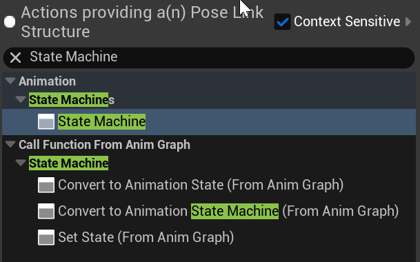
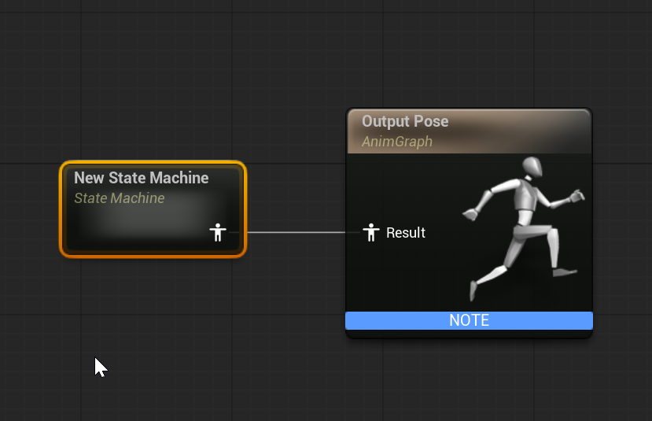
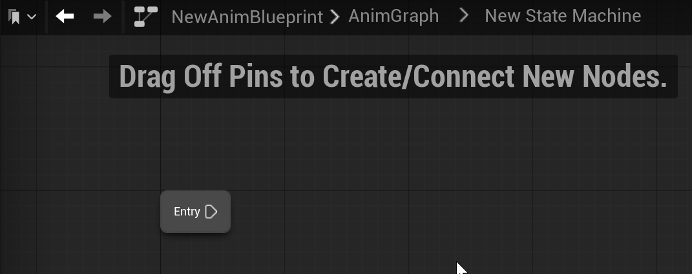
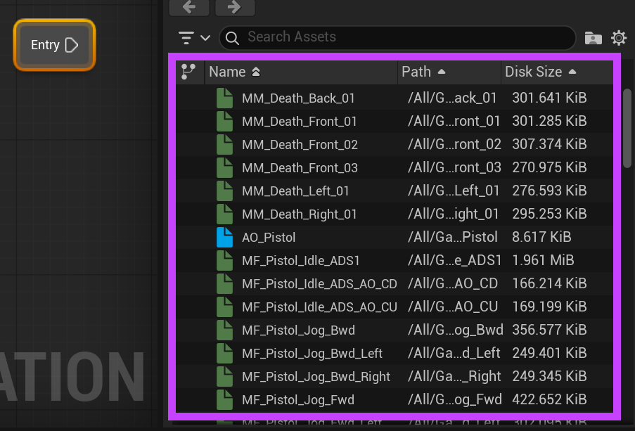

# Unreal: Animations: Reviewing State Machines

> Legacy lesson, organized for self-study. Screenshots may show an older editor. See the Unreal 5.8 verification scope (legacy attachment omitted) before relying on version-specific steps.

For situations where multiple conditions could lead to multiple outcome, Unreal uses the concept of a **state machine**. This borrows from computer science more generally where a *state machine* is a description of an abstraction where different rules define how values (the state) are changed.

A state machine has two main part:

- A state (current set of values).
- Transitions (conditions under which the machine moves to another state).

**A state machine allows us to express complex relationships as a series of rules. The transitions define when to move between states and the states define what should happen.**

In animation, a state machine defines each animation as its own state. We then define transitions for when the state machine should move between animations.

## Adding a State Machine

Pull off the "Result" input pin of the Output Pose node.

*Figure: Screenshot showing a search for "State Machine" from the Result pin.*

Once added, the State Machine is connected to the Output Pose.

*Figure: Screenshot showing the connected State Machine to Output Pose.*

Once the State Machine is created, double-click on it to open the state machine as its own graph.

*Figure: Screenshot of state machine "Entry" state.*

## Introducing State Machines in Unreal

In Unreal, animation blueprints is one of multiple situations where a state machine is used. (Another is in defining artificial intelligence such as might be used to define enemy behaviors in a game!)

An animation blueprint starts with an *end state*. This defines a current “end” or what it calls a **result**. Based on rules and relationships we define, we can end up in different possible *results* producing different animations.

By default, in the lower, right-hand corner will be an Asset Browser panel open with animations associated with the skeletal mesh connected to this animation blueprint. These are the possible states.

*Figure: Screenshot highlighting the animation Assets within the current project.*
