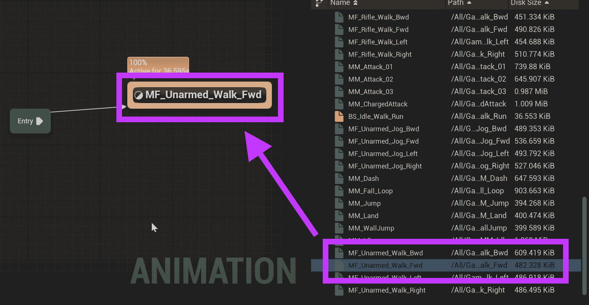
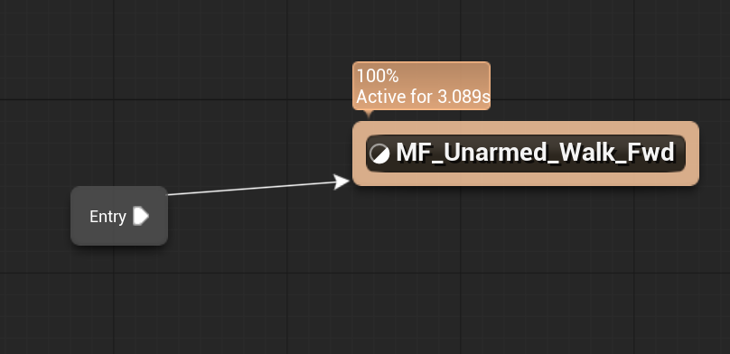
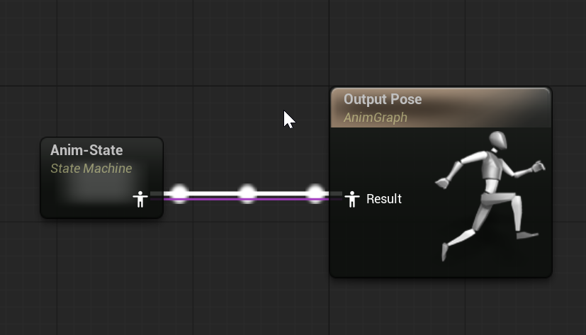
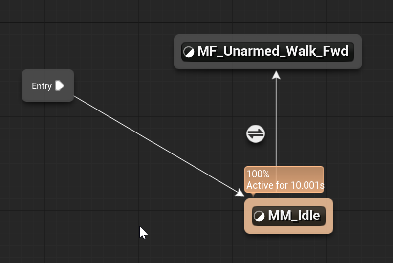

# Unreal: Animations: State Machine: Example: (1) Preparing States and Transitions

> Legacy lesson, organized for self-study. Screenshots may show an older editor. See the Unreal 5.8 verification scope (legacy attachment omitted) before relying on version-specific steps.

When a state (animation) is added to the Anim Graph, it is connected to the result, which is connected to the Output Pose.

Let's look at this relationship.

## Example

Drag and drop an animation from the Asset Browser.

Look for "MF_Unarmed_Walk_Fwd".

Drag and drop this asset onto the graph.

*Figure: Screenshot showing a dragged and dropped animation to create a state.*

Once added, drag from Entry to the new state (look for the green checkmark).

*Figure: Screenshot of added animation (state) connected to Entry.*

Click COMPILE.

Once the connection is made, Unreal will play the new animation state machine.

The reason for this is because the State Machine is feeding the animation data to the Output Pose.

*Figure: Screenshot of State Machine connected to Output Pose.*

## Transitions between States

Look for "MM_Idle" from the Asset Browser.

Drag and drop the animation to create a state.

Click and drag a connection between the states to create a *transition*.

*Figure: Screenshot of two states and a transition between them.*

To use this transition, we need to define a rule. For that, we need a variable.
