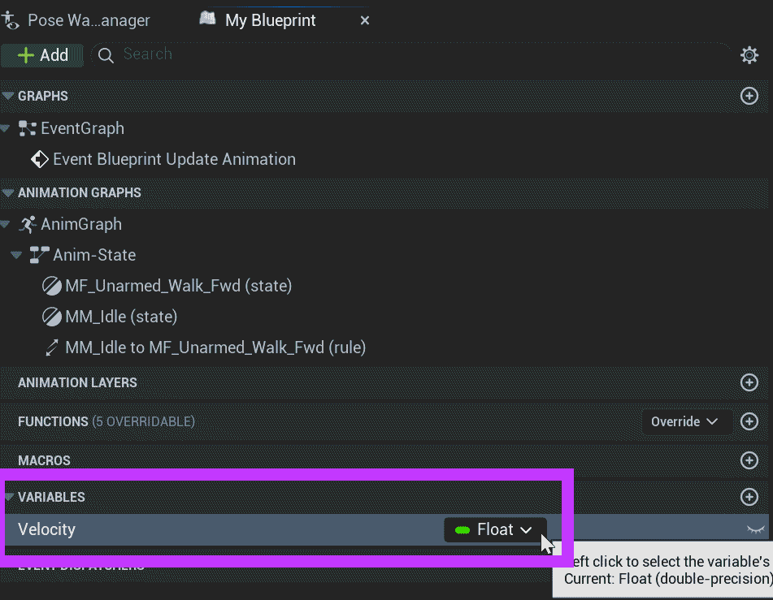
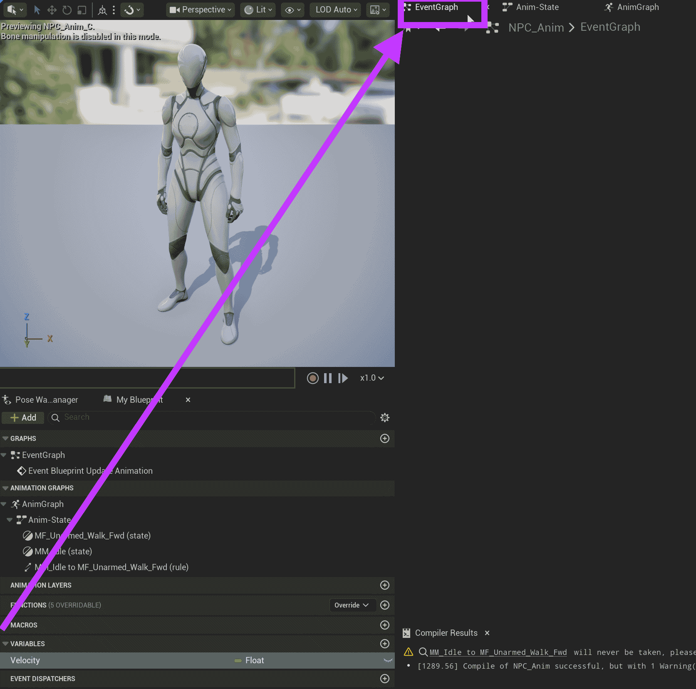
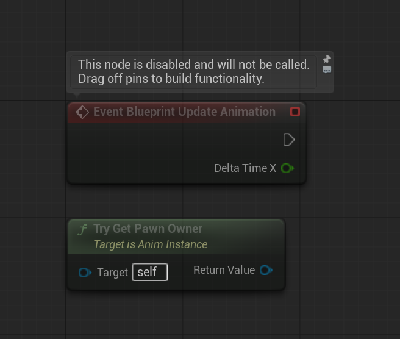
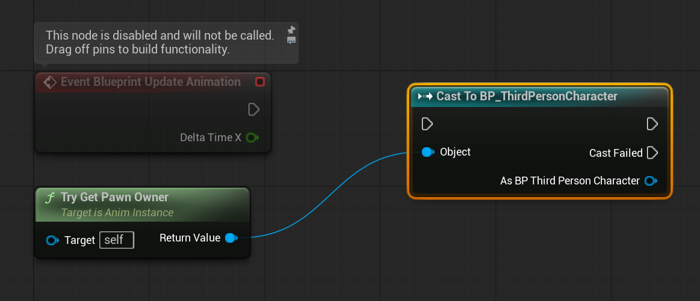
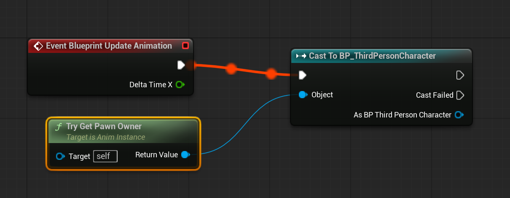
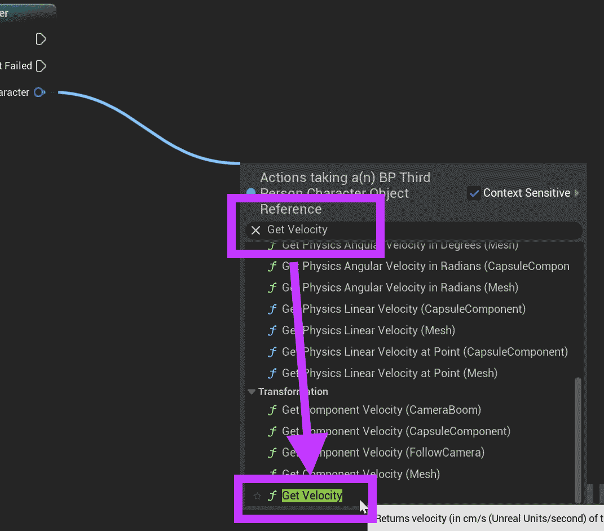
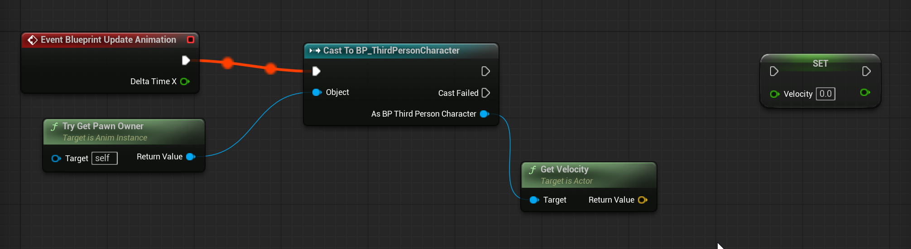
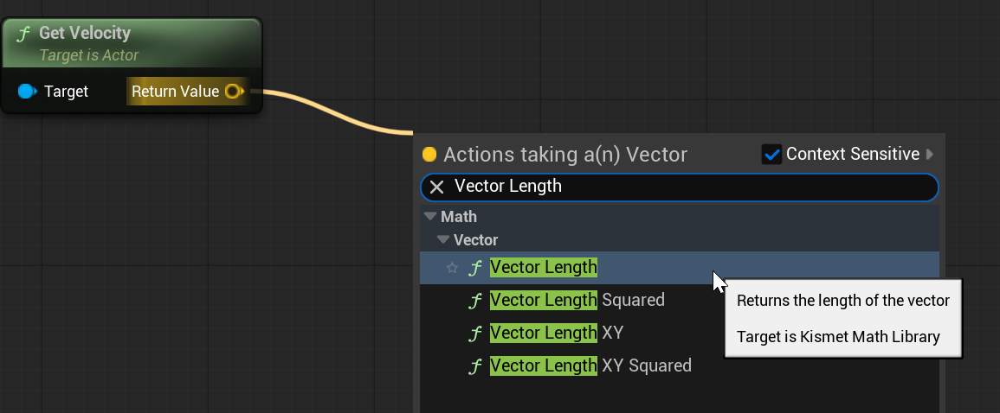
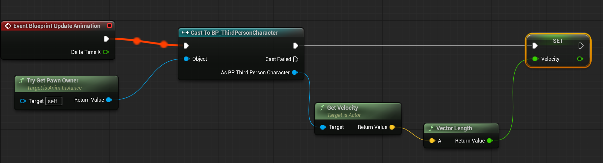

# Unreal: Animations: State Machine: Example: (2) Preparing Velocity as Anim Graph Variable

> Legacy lesson, organized for self-study. Screenshots may show an older editor. See the Unreal 5.8 verification scope (legacy attachment omitted) before relying on version-specific steps.

Transitions use defined rules to move between states. To define these rules, we need values *inside* the Anim Graph. This means we often want to define variables in the Anim Graph and then use its Event Graph to update these values.

Let's look at an example using *Velocity*, which is a common value used to determine if a Character is moving.

## Defining a Variable

In the Anim Graph, create a variable under the My Blueprint window.

*Figure: Screenshot of a created variable named "Velocity" of the Float data type.*

Go to the Event Graph.

*Figure: Screenshot highlighting the Event Graph.*

## Understanding Animation Event Graph

By default, there are will two nodes:

*Figure: Screenshot of Event Blueprint Update Animation and Try Get Pawn Owner.*

Animations are attached to Pawns, a type of actor a player controls.

## Actor -\> Pawn -\> Character

If the **Try Get Pawn Owner** node returns a *Pawn*, why are we mentioning *Character?*

In Unreal, Blueprints are built on each other. An Actor is something in a level. It can act. A Pawn is a type of Actor a player can control. A Character is a type of Pawn with movement components.

Put another way, we often have a First Person Character or a Third Person Character. A Third-Person Character is a Character. A Character is a Pawn.

This means we can access our player character by *casting* to our Blueprint (Third Person or First Person).

## Get the Player Character from The **Try Get Pawn Owner**

Let's pull off the Return Value output pin of the Try Get Pawn Owner node.

From this, cast to the player character Blueprint. (In this example, it is Third Person.)

*Figure: Screenshot of Cast To from Try Get Pawn Owner.*

Connect the output Exec pin of the Event Blueprint Update Animation to the input Exec pin of the Cast To node.

Once connected, the Anim Graph will show the flow between them.

Figure: Screenshot of connected flow from event to Cast To node.

Pull off the "As..." output pin, search for "Get Velocity" under the Transformation section. (You may need to scroll down.)

*Figure: Screenshot highlighting the "Get Velocity" node.*

Drag and drop the Velocity variable onto the Event Graph.

Choose to Set Velocity.

*Figure: Screenshot of sequence in progress with Set Velocity variable node.*

There is one more node we need.

The *Get Velocity* node returns a Vector across the x-axis, y-axis, and z-axis. We don't want that. We want the *length*, or the combined values of all of them.

Pull off the Return Value output pin of the *Get Velocity* and search for *Vector Length*:

*Figure: Screenshot of the context search for "Vector Length".*

This may seem strange, as we used Get Velocity and then linked this to Vector Length. The reason for this is because *Get Velocity* returns a vector (x, y, and z) based on the transformation. (Every actor has a Transform component containing its Location. Accessing anything having to do with transformation is connected to the *transform* component.) We need a single value.

By getting the length of the vector, it will perform the mathematics needed to create a single value based on the vector.

Pull off the return value of the Vector Length and then connect it to the Set Velocity node.

Pull off the output Exec pin of the Cast To node and connect it to the input Exec pin of the Set Velocity node.

*Figure: Screenshot of sequence from event to Set Velocity node.*

## *What does this do?*

This sequence performs an important action.

Each time the Animation Blueprint updates (generally every frame), it will access to the Character it is attached to and set its own internal Velocity variable to the length of the Actor's length.

Put another way, each frame, the Animation Blueprint will update itself based on values from another Blueprint.
