# Unreal: Animations: State Machine: Example: (3) Using Velocity during Transitions between States

> Legacy lesson, organized for self-study. Screenshots may show an older editor. See the Unreal 5.8 verification scope (legacy attachment omitted) before relying on version-specific steps.

We have previously created a *Velocity* local variable. We also connected it to the player character through the **Try Get Pawn Owner** node and then a **Cast To** node.

We now want to do something with it.

## Return to State Machine Graph

In an earlier step, we create a transition between states in the State Machine graph.

Right now, this transition does not work because it does not have a rule defined.

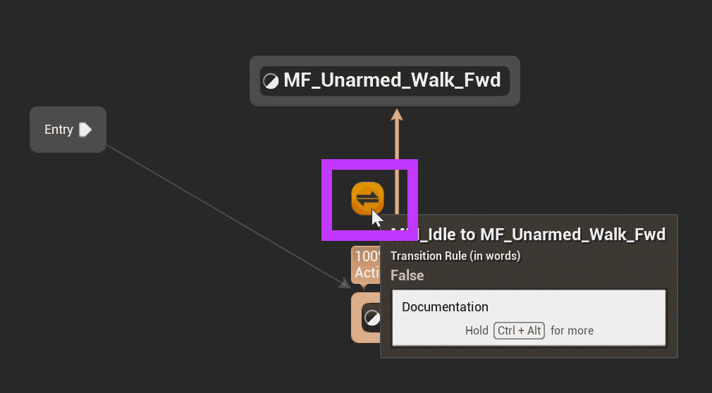

*Figure: Screenshot showing the transition between Idle and Walk.*

Double-click on the transition, which will open a sub-graph.

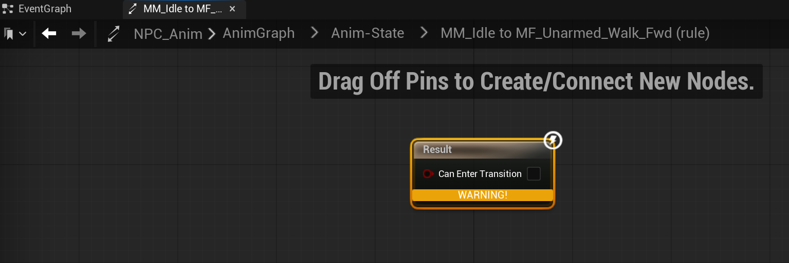

*Figure: Screenshot of the transition rule sub-graph.*

The node shows a WARNING!.

This is because it does not have input to make a decision.

A transition rule is some condition.

## Using Velocity (From Idle to Walk)

Generally, a good velocity length is around 10 Unreal units.

We want to perform the following steps:

- Get Velocity (which is being set by the Event Graph)
- Compare the Velocity using the Greater Than operator.
- Use the result connected to the Result node.

To do this, let's begin by dragging and dropping the Velocity variable. We want to get the value.

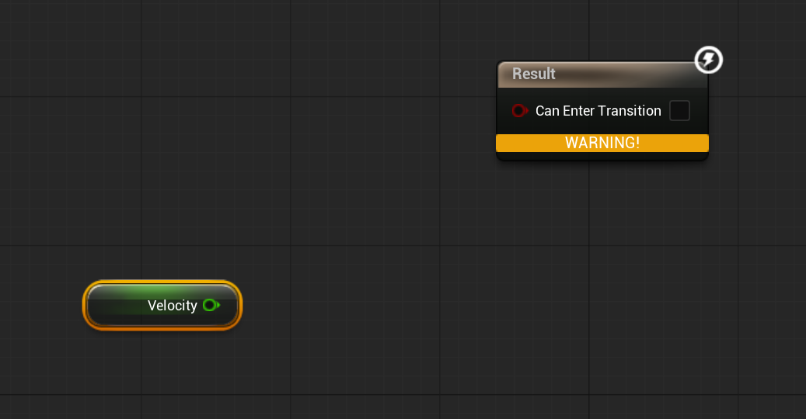

*Figure: Screenshot of Get Velocity variable.*

Pull off the Velocity node and search for "greater":

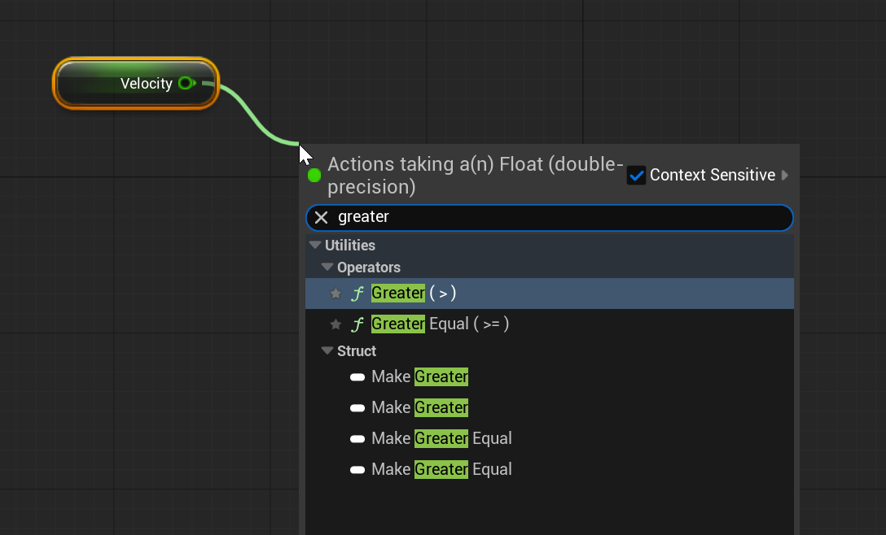

*Figure: Screenshot of "Greater" search from Velocity node.*

Connect the new Greater node to the Result node.

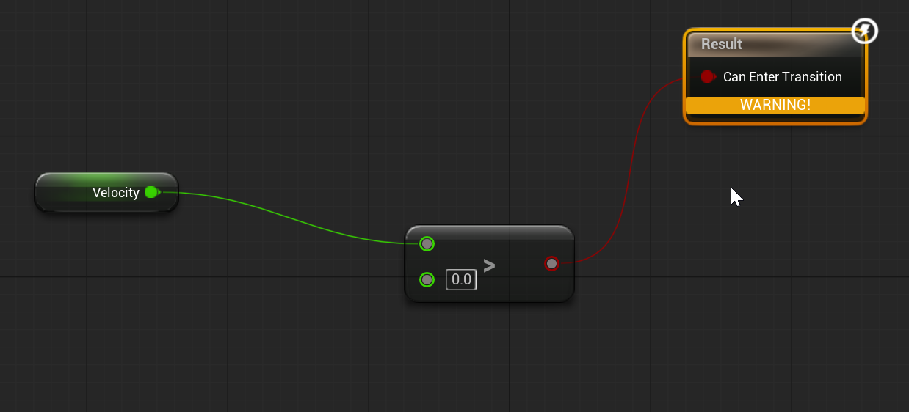

*Figure: Screenshot of sequence from Get Velocity to Result node.*

In the greater node, change the input amount from 0.0 to 10.0:

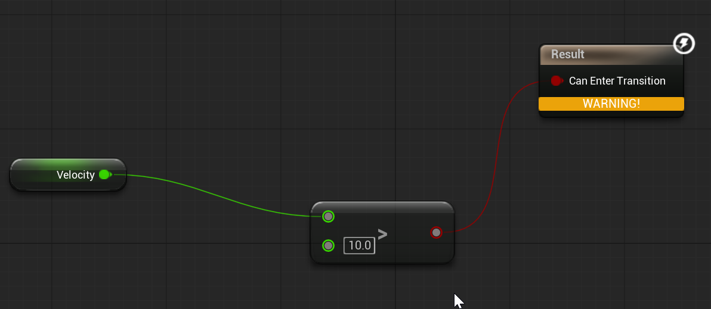

*Figure: Screenshot of completed sequence comparing Velocity \> 10.*

Click COMPILE.

We have now completed one transition.

In the new animation, we will move from Idle to Walk based on the value of Velocity, which will be updated every frame.

Let's now complete the other transition from Walk to Idle.

## Using Velocity (From Walk to Idle)

Return to the Animation State Machine Graph.

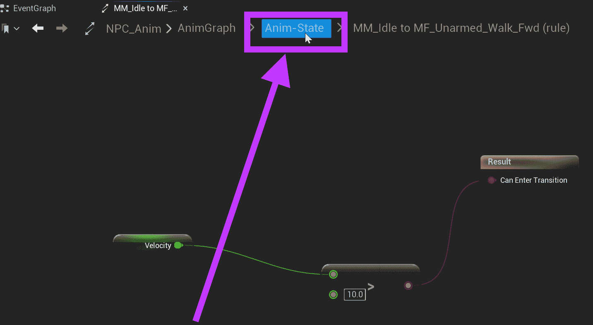

*Figure: Screenshot highlighting the State Machine graph.*

Drag from Walk to Idle, creating a new transition.

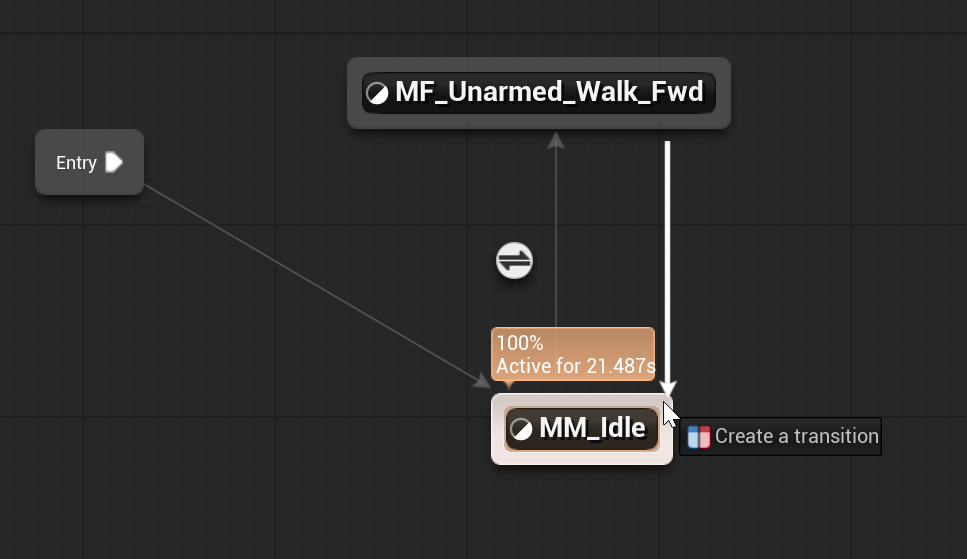

*Figure: Creating a transition from Walk to Idle.*

With the new transition created, an arrow will point from Walk to Idle matching the previous transition from Idle to Walk.

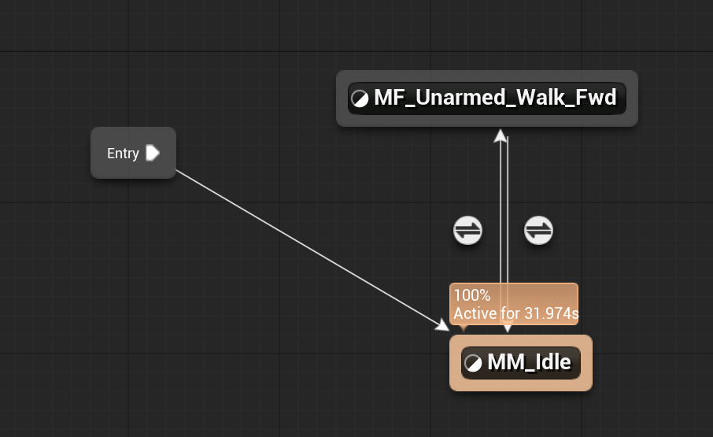

*Figure: Screenshot of two transitions between states.*

Double-click on the transition icon from Walk to Idle.

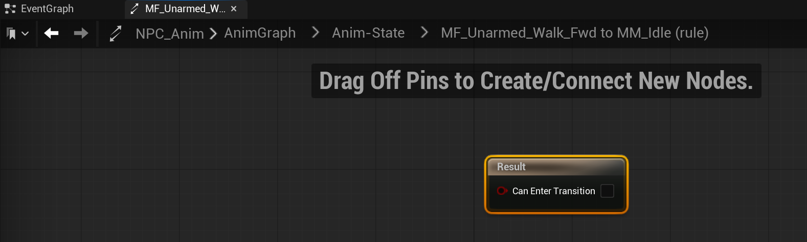

*Figure: Screenshot showing the rule for the transition between Walk to Idle.*

We will repeat the same nodes for Idle to Walk but use Less for this sequence.

- Get the Velocity value.
- Pull off for access to Less.
- Set the value to compare for 10.
- Connect the operator to the Result node.

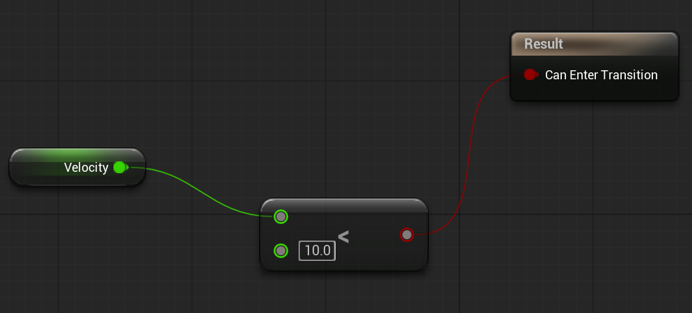

*Figure: Screenshot of sequence using Less.*

Click COMPILE.

Use File -\> Save All.
