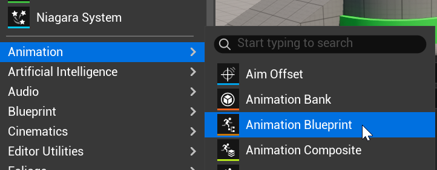
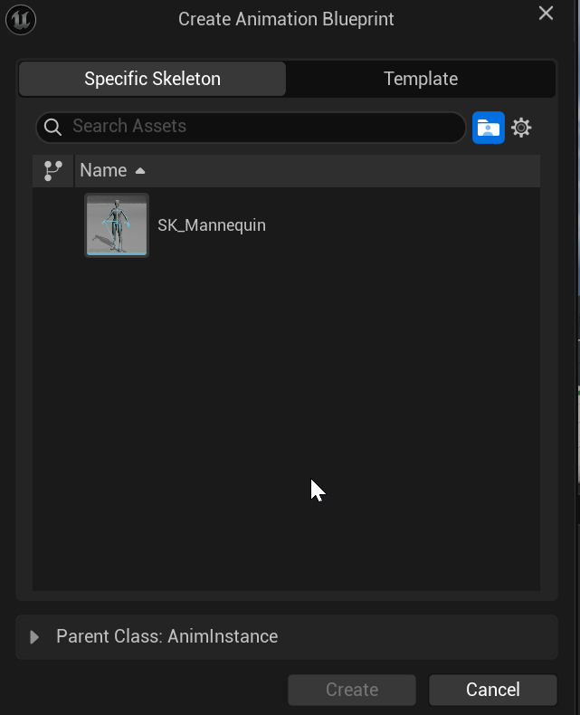
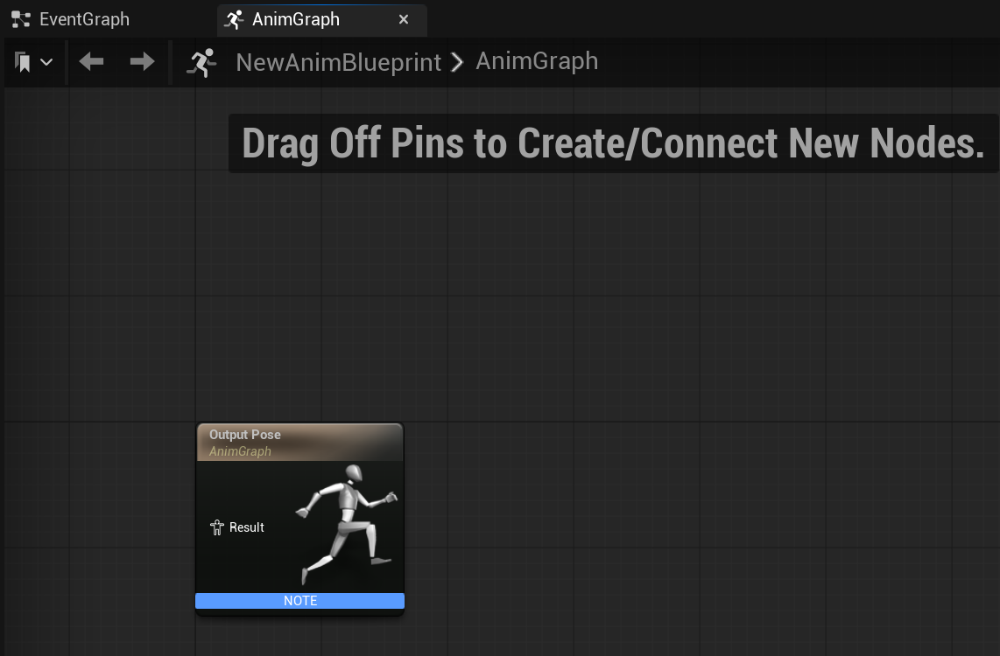

# Unreal: Animations: What is an animation? (Animation Blueprint)

> Legacy lesson, organized for self-study. Screenshots may show an older editor. See the Unreal 5.8 verification scope (legacy attachment omitted) before relying on version-specific steps.

In Unreal, we create Animation Blueprints to describe how some skeleton mesh should move (animate) based on rules we defined.

**To create an animation blueprint, we must select an existing skeletal mesh in the project. You cannot have a "free" animation blueprint without attaching it to some skeletal mesh**

## Creating an Animation Blueprint

Like all Blueprints, we create them in the Content Drawer.

*Figure: Screenshot of the Animation -\> Animation Blueprint workflow.*

During the creation process, we must select an existing skeletal mesh in the project.

*Figure: Screenshot of selecting a skeleton.*

## Using Animation (Anim) Blueprint

An Animation (Anim) Graph defines the nodes "starting" with what the final output will be when the connections between nodes finish.

*Figure: Screenshot of AnimGraph showing the "Output Pose" node.*
