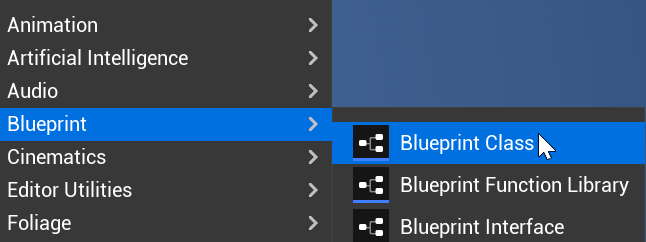
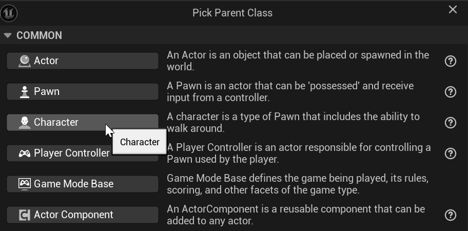
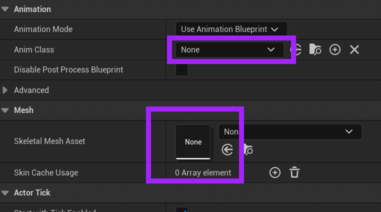

# Unreal: Characters: A Character is a Skeletal Mesh + Animation Graph + Character Movement

> Legacy lesson, organized for self-study. Screenshots may show an older editor. See the Unreal 5.8 verification scope (legacy attachment omitted) before relying on version-specific steps.

Let's create a new Character.

## Creating a Character

In the Content Drawer, use the Add button.

Select Blueprint -\>Blueprint Class.

*Figure: Screenshot showing Blueprint -\> Blueprint Class.*

In the window, select Character as the parent class.

*Figure: Screenshot showing Parent Classes.*

## Examining a Character

There are two import sections to highlight. If we want to see a character, it needs some skeletal mesh. If we want to animate that skeletal mesh, we need an Animation Blueprint (Anim Class) configured for that Skeletal Mesh.

*Figure: Screenshot of Animation and Mesh sections of a Character class.*
