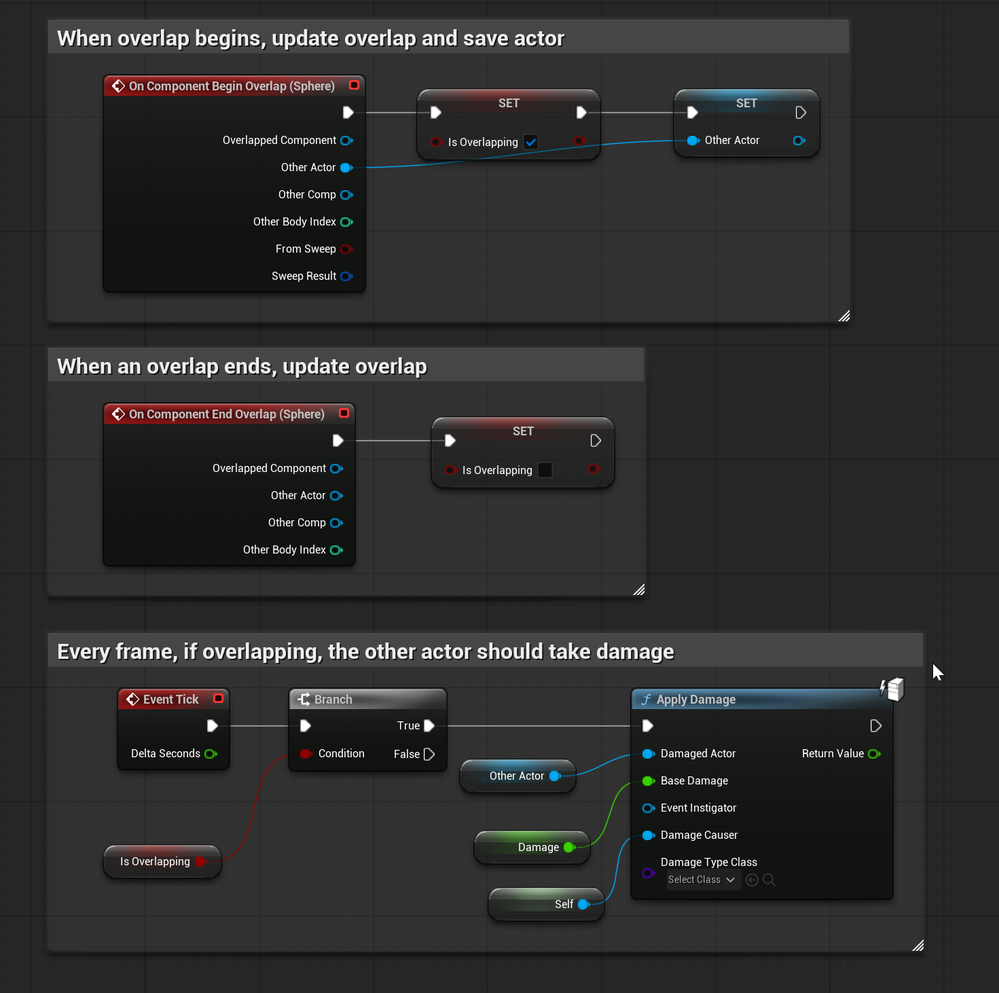

# Unreal: Damage System: Attacks

> Legacy lesson, organized for self-study. Screenshots may show an older editor. See the Unreal 5.8 verification scope (legacy attachment omitted) before relying on version-specific steps.

In Unreal, an *attack* is some usage of the **Apply Damage** node. If we define a variable using a *Damage* value, we can "apply" that damage to some other actor (such as the player-character). If the other actor has the On Take Any Damage event, it will "receive" the damage amount and can act on it in some way.

## Example: Recurring damage such as lava or poison

*Figure: Screenshot of complex sequences of saving actor on overlap and applying damage every tick.*
