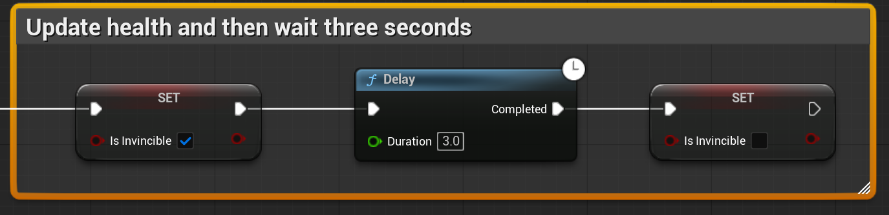
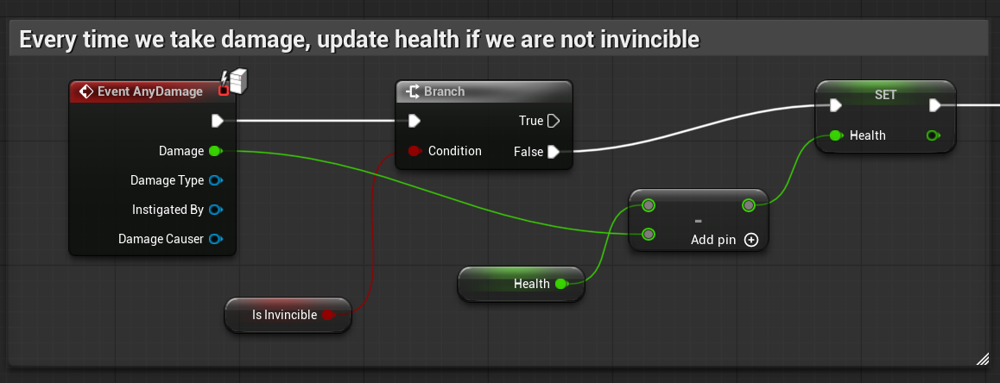

# Unreal: Damage System: Invincibility Frames

> Legacy lesson, organized for self-study. Screenshots may show an older editor. See the Unreal 5.8 verification scope (legacy attachment omitted) before relying on version-specific steps.

Using the On Take Any Damage, we can create a common concept to games, *invincibility frames*. Commonly called "i-frames," many games use an approach to stopping a player-character from constantly taking damage from some sources. Generally, this is about three seconds.

*Figure: Screenshot of the use of Delay node to create invincibility and then remove it*

## Example: On Take Any Damage

*Figure: Screenshot of One Take Any Damage sequence*
